# Hybrid Stock Market Forecasting: Lecture Notes and Results Walkthrough

**ARIMA, SARIMA, GARCH, LSTM, N-BEATS and two statistical-neural hybrids on 18 years of Indian and US equity data**

*Rajarshi Chakraborty · Final-Year Project · lecture and pitch companion*

| | |
|---|---|
| Notebook | `stock_market_final_year_project.ipynb` |
| Documented run | `stock_market_final_year_project.ipynb`, executed on Google Colab with a T4 GPU, 8 November 2026 |
| Run time | 37.4 minutes, 0 errors, 63 output files |
| Data | Yahoo Finance daily prices, 3 March 2008 to 6 November 2026, 5 assets and 2 volatility indices |
| Every number, table, printed line and figure in this document | copied automatically from that run, not typed by hand |

---

## How to read this document

The document follows the notebook from the first cell to the last. For every step it answers four questions:

1. **What happens and why** (plain language).
2. **The mathematics** behind it (with derivations where they matter).
3. **The code** that does it (the actual function from the notebook).
4. **The output** of the cell (the real tables, prints and graphs) and **how to read it**.

Part A is a two-minute pitch. Part B gives the big picture. Part C is the cell-by-cell walkthrough. Part D tells the engineering story: the errors found during development and the optimisations that fixed them. Part E introduces the volatility extension in the latest notebook version. Part F prepares answers to the questions examiners are most likely to ask.

### Contents

* **Part A** · The pitch in two minutes
* **Part B** · The big picture: problem, pipeline, timeline, notation
* **Part C** · Cell-by-cell walkthrough
  * C.1 Setup · C.2 Data acquisition · C.3 Data quality and features · C.4 Exploratory analysis · C.5 Stationarity
  * C.6 Experimental design and metrics · C.7 ARIMA · C.8 SARIMA · C.9 GARCH
  * C.10 LSTM · C.11 N-BEATS · C.12 Hybrid models
  * C.13 Evaluation (13.1 to 13.10) · C.14 Uncertainty · C.15 Multi-asset · C.16 Future forecast · C.17 Auto summary · C.18 Export
* **Part D** · Errors found and optimisations made
* **Part E** · The volatility extension (latest version)
* **Part F** · Questions examiners will ask, with answers
* **Part G** · Glossary and references

---

# Part A · The pitch in two minutes

**The problem.** Can machine learning forecast the stock market? Thousands of student projects claim it can, usually by showing a predicted price curve lying on top of the real one. That picture proves nothing: tomorrow's price is almost always close to today's, so even a model that simply repeats today's price looks perfect. The real question is whether a model predicts the *change* (the return) better than chance.

**What this project does differently.** It treats stock forecasting as a scientific test, not a demo:

* Eight models are compared under one leak-free protocol: two naive baselines (random walk and drift), two classical statistical models (ARIMA and a weekly SARIMA), two deep-learning models (a multi-feature LSTM and N-BEATS) and two **statistical-neural hybrids** (Hybrid-R and Hybrid-E).
* The models are trained on 2008 to 2019, tuned on 2020 to 2021 (including the COVID-19 crash), and tested **once** on 1,197 unseen trading days from January 2022 to November 2026.
* Success is judged the way finance research judges it: out-of-sample R² against the random walk, directional accuracy with the Pesaran-Timmermann test, Diebold-Mariano significance tests with a Holm correction, block-bootstrap confidence intervals, a trading back-test after costs, and calibrated prediction intervals.
* Everything is repeated on five assets: NIFTY 50, NIFTY Bank, Reliance, TCS and the S&P 500.

**Key results on the NIFTY 50 (1,197 unseen test days).**

| Result | Value | Meaning |
|---|---|---|
| Best day-ahead model | **Hybrid-R** (proposed) | best or tied-best of all 8 models on every day-ahead measure |
| Out-of-sample R² against the random walk | **+0.35 %** | Hybrid-R's squared error is 0.35 % smaller than "tomorrow = today" |
| Directional accuracy | **53.22 %**, Pesaran-Timmermann **p = 0.0008** | predicts the sign of the next move better than chance |
| Trading back-test (long or cash, after 0.05 % costs) | **Sharpe 0.671** vs 0.626 for buy and hold | **+7.2 %** better risk-adjusted return, smaller drawdown |
| Annual return of the strategy | **8.67 %** vs 8.00 % for buy and hold | |
| Effect of the hybrid design (ablation) | removing the neural correction lowers R²_OS by 0.15 points | the LSTM correction adds measurable skill to SARIMA |
| 95 % prediction intervals | 95.6 % coverage (Gaussian GARCH) | uncertainty is stated honestly and verified on unseen data |
| GARCH volatility persistence | 0.994, half-life 115 trading days | volatility is highly predictable, prices are not |

**The honest message.** After correcting for comparing against seven models at once, none of the day-ahead error improvements is statistically significant, and across the five assets the picture is mixed. This is exactly what the efficient-market hypothesis predicts, and the project proves it with the full statistical toolkit instead of hiding it. The positive, significant findings are the **directional edge** of Hybrid-R and the strong **predictability of volatility**, which the latest notebook version turns into a full volatility-forecasting study (Part E).

---

# Part B · The big picture

## B.1 Why stock prediction is hard

The **efficient-market hypothesis** (Fama, 1970) says that prices already contain all public information. If a predictable rise were known for tomorrow, traders would buy today and the rise would happen today. The consequence is that the log price behaves almost like a **random walk**:

$$\ln P_t = \ln P_{t-1} + \mu + \varepsilon_t, \qquad \mathbb E[\varepsilon_t \mid \text{past}] = 0 .$$

Under this model the best forecast of tomorrow's price is today's price (plus a tiny drift $\mu$). Any model must therefore be judged *against the random walk*, not against zero.

Three facts about real returns, the **stylised facts** (Cont, 2001), shape every design decision in this project:

| Stylised fact | What it means | Design consequence |
|---|---|---|
| Returns are almost uncorrelated | yesterday's return says little about today's | the random walk is a strong benchmark; gains will be small |
| Returns have fat tails | crashes are far more frequent than a normal distribution allows | Gaussian error bars are too narrow; conformal intervals are used |
| Volatility clusters | calm and turbulent periods persist for weeks | volatility is predictable; GARCH is used for risk and scaling |

## B.2 The pipeline

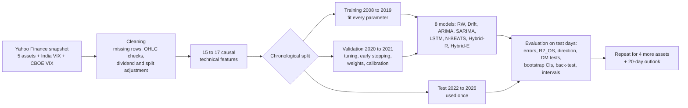

## B.3 The timeline

```
2008-05 ............................................ 2019-12 | 2020-01 ... 2021-12 | 2022-01 ....... 2026-11
             TRAINING (2,836 trading days)                   | VALIDATION (498)    | TEST (1,197)
  every model parameter is estimated here                     | hyperparameters,    | touched exactly once,
                                                              | early stopping,     | every day is a target
                                                              | hybrid weights,     | at every lead from
                                                              | interval calibration| 1 to 20 trading days
```

The validation years contain the COVID-19 crash of March 2020, the most violent sell-off in the data after 2008. This makes validation hard and is one reason the neural targets are scaled by volatility (Section C.10).

## B.4 Notation

| Symbol | Meaning |
|---|---|
| $P_t$ | adjusted closing price on trading day $t$ |
| $r_t = \ln(P_t / P_{t-1})$ | daily log return |
| $R_{t,h} = \ln P_{t+h} - \ln P_t = \sum_{k=1}^{h} r_{t+k}$ | cumulative log return over the next $h$ days |
| $H = 20$ | longest forecast horizon (about one trading month) |
| $\hat R_{t,h}$ | a model's forecast of $R_{t,h}$, made at the close of day $t$ |
| $\hat P_{t+h} = P_t \exp(\hat R_{t,h})$ | the corresponding price forecast |
| $\varepsilon_t$ | one-step forecast error (innovation) of SARIMA |
| $\sigma_t^2$ | conditional variance from GARCH |
| $\hat s_{t,h}$ | GARCH forecast standard deviation of $R_{t,h}$ |

The key idea of the notation: **every model forecasts returns, and prices are rebuilt from them.** This is mathematically equivalent to forecasting prices, but it keeps the problem stationary (Section C.5).

---

# Part C · Cell-by-cell walkthrough

## C.1 Setup (notebook Section 1)

**Cell 1.1 · Libraries.** Imports NumPy, pandas, SciPy, statsmodels, scikit-learn, TensorFlow and Keras, silences TensorFlow's start-up logging, and prints the versions and the accelerator.

```text
Python 3.13.16 · NumPy 2.4.6 · pandas 2.2.3 · statsmodels 0.15.0 · TensorFlow 2.21.0
Accelerator: GPU (/physical_device:GPU:0)
```

The run used Python 3.13, statsmodels 0.15 and TensorFlow 2.21 on a GPU, which matters for reproducibility: the exact versions are also saved in `outputs/run_config.json`.

**Cell 1.2 · Configuration.** Every setting lives in one cell, so the whole study can be re-run with a different period, asset list or search budget without touching any other code. The most important settings:

```python
ASSETS = {
    "NIFTY 50": ("^NSEI", "nifty50", "indiavix"),
    "NIFTY Bank": ("^NSEBANK", "niftybank", "indiavix"),
    "Reliance": ("RELIANCE.NS", "reliance", "indiavix"),
    "TCS": ("TCS.NS", "tcs", "indiavix"),
    "S&P 500": ("^GSPC", "sp500", "vix"),
}
VOL_INDICES = {"indiavix": "^INDIAVIX", "vix": "^VIX"}
```

```python
FORECAST_HORIZON = 20
LEAD_CHECKPOINTS = (1, 2, 5, 10, 20)
TRADING_DAYS = 252
COST = 0.0005
N_ENSEMBLE = 3
MAX_EPOCHS = 200
LSTM_SPACE = {"lookback": (10, 20, 60), "units": ((32, 16), (64, 32), (128, 64)), "dropout": (0.2, 0.3, 0.5),
              "learning_rate": (1e-4, 3e-4, 1e-3), "batch_size": (32, 64, 128)}
LSTM_DEFAULT = {"lookback": 20, "units": (64, 32), "dropout": 0.3, "learning_rate": 3e-4, "batch_size": 64}
LSTM_TRIALS = 10
NBEATS_SPACE = {"lookback": (20, 60, 120), "dropout": (0.1, 0.3), "learning_rate": (1e-4, 3e-4)}
NBEATS_DEFAULT = {"lookback": 60, "dropout": 0.1, "learning_rate": 1e-4}
NBEATS_TRIALS = 5
NB_BLOCKS = 3
NB_UNITS = 128
ARMA_MAX = 3
SARIMA_MAX = 2
SEASONAL_PERIOD = 5
ALPHA = 0.05
N_JOBS = -1
```

The cell has no output. `SEED = 42` fixes all random numbers, `COST = 0.0005` is the 0.05 % transaction cost per trade, and the two search spaces define the hyperparameters the networks may use (Section C.10).

**Cell 1.3 · Figure style.** Defines one fixed colour per model (the same in every figure) and two helpers: `finish`, which numbers and saves every figure at 300 dpi, and `show_table`, which numbers every table and highlights the best value in bold. No output.

## C.2 Data acquisition (notebook Section 2)

**What happens.** Daily open, high, low, close and volume for five assets, plus the India VIX and the CBOE VIX, are loaded for 3 March 2008 to 6 November 2026. Free data APIs are rate-limited and revise their history, so the project ships a **frozen snapshot** in `app/data/market/`. The loader tries three sources in order: the local folder, the snapshot on GitHub, and the live Yahoo Finance chart API.

```python
def fetch_market(slug, ticker):
    path = DATA_DIR / f"{slug}.csv"
    attempts = [("local snapshot", lambda: read_snapshot(path)),
                ("GitHub snapshot", lambda: read_snapshot(MIRROR_URL.format(slug=slug))),
                ("Yahoo Finance API", lambda: download_yahoo(ticker))]
    problems = []
    for label, load in attempts:
        try:
            raw = load()
        except Exception as error:
            problems.append(f"{label}: {type(error).__name__} {error}")
            continue
        raw = raw.loc[(raw["date"] >= START_DATE) & (raw["date"] <= END_DATE)].reset_index(drop=True)
        if label != "local snapshot":
            raw.to_csv(path, index=False)
        return raw, label
    raise RuntimeError(f"Market data for {ticker} could not be loaded. " + " | ".join(problems))
```

**Output.**

```text
^NSEI        4,611 rows · 03 Mar 2008 to 06 Nov 2026 · source: GitHub snapshot
^NSEBANK     4,611 rows · 03 Mar 2008 to 06 Nov 2026 · source: GitHub snapshot
RELIANCE.NS  4,611 rows · 03 Mar 2008 to 06 Nov 2026 · source: GitHub snapshot
TCS.NS       4,611 rows · 03 Mar 2008 to 06 Nov 2026 · source: GitHub snapshot
^GSPC        4,702 rows · 03 Mar 2008 to 06 Nov 2026 · source: GitHub snapshot
^INDIAVIX    4,611 rows · 03 Mar 2008 to 06 Nov 2026 · source: GitHub snapshot
^VIX         4,875 rows · 03 Mar 2008 to 06 Nov 2026 · source: GitHub snapshot
```

Every series came from the GitHub snapshot, so every run uses byte-identical data. The last raw rows of the NIFTY 50:

|  | date | open | high | low | close | adjclose | volume |
|---|---|---|---|---|---|---|---|
| 4606 | 2026-11-02 | 23222.300781 | 23440.800781 | 23207.050781 | 23440.800781 | 23440.800781 | 383400.0 |
| 4607 | 2026-11-03 | 23582.250000 | 23810.849609 | 23482.800781 | 23810.849609 | 23810.849609 | 408400.0 |
| 4608 | 2026-11-04 | 23742.250000 | 23960.599609 | 23696.150391 | 23960.599609 | 23960.599609 | 398400.0 |
| 4609 | 2026-11-05 | 24378.050781 | 24579.900391 | 24296.300781 | 24536.599609 | 24536.599609 | 534600.0 |
| 4610 | 2026-11-06 | 24538.199219 | 25030.349609 | 24388.050781 | 25030.349609 | 25030.349609 | 491000.0 |

The last date is Friday 6 November 2026. Sunday 8 November 2026 (a one-hour Diwali *Muhurat* trading session) was deliberately excluded because it is not a normal trading day.

## C.3 Data quality and feature engineering (notebook Section 3)

**What happens.** Raw market data contain defects. Each one is counted and fixed:

1. duplicate dates are removed;
2. rows without a complete open, high, low and close (exchange holidays reported as empty rows) are dropped, so the analysis uses **trading days only**;
3. non-positive prices are dropped;
4. the high must be the largest and the low the smallest of the four prices;
5. dividends and splits are removed by multiplying all four prices by $\text{adjusted close} / \text{close}$;
6. the volatility index is matched to the asset's trading days and carried forward for at most 5 days;
7. daily moves above 10 % are **kept**, because they are real events (the 2008 crisis, the 2009 election result, the 2020 crash).

```python
def clean_market(raw, vol_raw):
    df = raw.copy()
    n_duplicates = int(df["date"].duplicated().sum())
    df = df.drop_duplicates("date").set_index("date").sort_index()
    price_cols = ["open", "high", "low", "close", "adjclose"]
    missing = df[price_cols].isna().any(axis=1)
    n_missing = int(missing.sum())
    df = df.loc[~missing]
    invalid = (df[price_cols] <= 0).any(axis=1)
    n_invalid = int(invalid.sum())
    df = df.loc[~invalid]
    top, bottom = df[["open", "high", "close"]].max(axis=1), df[["open", "low", "close"]].min(axis=1)
    n_ohlc = int(((df["high"] < top - 1e-9) | (df["low"] > bottom + 1e-9)).sum())
    df["high"], df["low"] = top, bottom
    factor = df["adjclose"] / df["close"]
    n_adjusted = int((np.abs(factor - 1) > 1e-4).sum())
    for col in ("open", "high", "low", "close"):
        df[col] = df[col] * factor
    df["volume"] = df["volume"].fillna(0)
    vol = vol_raw.drop_duplicates("date").set_index("date").sort_index()["close"]
    vol = vol[vol > 0]
    aligned = vol.reindex(df.index)
    n_vol_filled = int(aligned.isna().sum())
    df["vix"] = aligned.ffill(limit=5).bfill(limit=5)
    n_no_vix = int(df["vix"].isna().sum())
    df = df.loc[df["vix"].notna()]
    n_extreme = int((np.log(df["close"]).diff().abs() > 0.10).sum())
    quality = pd.DataFrame([
        ("Duplicate dates", f"{n_duplicates:,}", "removed (first record kept)"),
        ("Rows with missing prices", f"{n_missing:,}", "dropped (non-trading days)"),
        ("Non-positive prices", f"{n_invalid:,}", "dropped"),
        ("OHLC inconsistencies", f"{n_ohlc:,}", "high and low repaired"),
        ("Days adjusted for dividends or splits", f"{n_adjusted:,}", "prices multiplied by adjusted / raw close"),
        ("Volatility-index gaps", f"{n_vol_filled:,}", f"carried forward (≤ 5 days); {n_no_vix} days without VIX dropped"),
        ("Daily moves above 10 %", f"{n_extreme:,}", "kept (genuine market events)"),
        ("Analysis-ready series", f"{len(df):,} trading days · {df.index[0]:%d %b %Y} to {df.index[-1]:%d %b %Y}",
         "0 missing values"),
    ], columns=["Check", "Finding", "Action"])
    return df[["open", "high", "low", "close", "volume", "vix"]], quality
```

**Output.**

**Table 1 · Data-quality audit for NIFTY 50**

| Check | Finding | Action |
|---|---|---|
| Duplicate dates | 0 | removed (first record kept) |
| Rows with missing prices | 31 | dropped (non-trading days) |
| Non-positive prices | 0 | dropped |
| OHLC inconsistencies | 0 | high and low repaired |
| Days adjusted for dividends or splits | 0 | prices multiplied by adjusted / raw close |
| Volatility-index gaps | 19 | carried forward (≤ 5 days); 0 days without VIX dropped |
| Daily moves above 10 % | 3 | kept (genuine market events) |
| Analysis-ready series | 4,580 trading days · 03 Mar 2008 to 06 Nov 2026 | 0 missing values |

**Table 2 · Data-quality audit for all five assets**

| Check | Duplicate dates | Rows with missing prices | Non-positive prices | OHLC inconsistencies | Days adjusted for dividends or splits | Volatility-index gaps | Daily moves above 10 % | Analysis-ready series |
|---|---|---|---|---|---|---|---|---|
| NIFTY 50 | 0 | 31 | 0 | 0 | 0 | 19 | 3 | 4,580 trading days · 03 Mar 2008 to 06 Nov 2026 |
| NIFTY Bank | 0 | 16 | 0 | 0 | 0 | 18 | 4 | 4,595 trading days · 03 Mar 2008 to 06 Nov 2026 |
| Reliance | 0 | 7 | 0 | 0 | 4,497 | 27 | 13 | 4,604 trading days · 03 Mar 2008 to 06 Nov 2026 |
| TCS | 0 | 7 | 0 | 0 | 4,587 | 27 | 6 | 4,604 trading days · 03 Mar 2008 to 06 Nov 2026 |
| S&P 500 | 0 | 0 | 0 | 0 | 0 | 0 | 3 | 4,702 trading days · 03 Mar 2008 to 06 Nov 2026 |

**Reading Tables 1 and 2.** The data are clean: no duplicates, no invalid prices and no OHLC errors. The 31 NIFTY 50 rows with missing prices are exchange holidays. Reliance and TCS have almost every day adjusted, because their adjusted close differs from the raw close after every dividend; the indices need no adjustment. The India VIX had 18 to 27 gaps per Indian asset (days when it was not published), filled from the previous day; the S&P 500 had none.

### Feature engineering

The networks receive technical features computed **only from data up to and including day $t$**, so no future information can leak into the inputs.

| Feature | Formula | Captures |
|---|---|---|
| Daily return | $r_t = \ln(P_t/P_{t-1})$ | the series itself |
| Momentum | $\sum_{k=0}^{4} r_{t-k}$ and $\sum_{k=0}^{20} r_{t-k}$ | weekly and monthly trend |
| Realised volatility | standard deviation of the last 5 and 21 returns | recent risk |
| Range | $\ln(H_t/L_t)$ | intraday volatility |
| Body and gap | $\ln(C_t/O_t)$ and $\ln(O_t/C_{t-1})$ | intraday and overnight moves |
| RSI (14) | $100 - \dfrac{100}{1 + \text{EMA}_{14}(\text{gains}) / \text{EMA}_{14}(\text{losses})}$ | overbought or oversold |
| MACD histogram | $\dfrac{\text{EMA}_{12}(P) - \text{EMA}_{26}(P)}{P} - \text{EMA}_9(\cdot)$ | trend changes |
| Bollinger %B | $\dfrac{P_t - (m_{20} - 2 s_{20})}{4 s_{20}}$ | position inside the 20-day bands |
| ATR (14) | $\text{EMA}_{14}\big(\max(H-L,\ \lvert H - C_{-1}\rvert,\ \lvert L - C_{-1}\rvert)\big) / P$ | volatility including gaps |
| Gap to 50-day MA | $\ln(P_t / \text{MA}_{50})$ | distance from the trend |
| Volatility index | $\ln \text{VIX}_t$ and its daily change | market fear |
| Volume | change and 21-day z-score of $\ln V_t$ | activity (only when volume exists on at least 95 % of training days) |

```python
def make_features(df, use_volume):
    close = df["close"]
    r = np.log(close).diff()
    f = pd.DataFrame(index=df.index)
    f["ret"] = r
    f["ret_5"], f["ret_21"] = r.rolling(5).sum(), r.rolling(21).sum()
    f["vol_5"], f["vol_21"] = r.rolling(5).std(), r.rolling(21).std()
    f["range"] = np.log(df["high"] / df["low"])
    f["body"] = np.log(close / df["open"])
    f["gap"] = np.log(df["open"] / close.shift(1))
    change = close.diff()
    gain = change.clip(lower=0).ewm(alpha=1 / 14, adjust=False).mean()
    loss = (-change.clip(upper=0)).ewm(alpha=1 / 14, adjust=False).mean()
    f["rsi"] = 100 - 100 / (1 + gain / loss)
    macd = (close.ewm(span=12, adjust=False).mean() - close.ewm(span=26, adjust=False).mean()) / close
    f["macd_hist"] = macd - macd.ewm(span=9, adjust=False).mean()
    middle, spread = close.rolling(20).mean(), close.rolling(20).std()
    f["bb_pctb"] = (close - (middle - 2 * spread)) / (4 * spread)
    true_range = pd.concat([df["high"] - df["low"], (df["high"] - close.shift(1)).abs(), (df["low"] - close.shift(1)).abs()], axis=1).max(axis=1)
    f["atr"] = true_range.ewm(alpha=1 / 14, adjust=False).mean() / close
    f["ma50_gap"] = np.log(close / close.rolling(50).mean())
    f["vix"] = np.log(df["vix"])
    f["vix_chg"] = f["vix"].diff()
    if use_volume:
        log_volume = np.log(df["volume"].where(df["volume"] > 0)).ffill()
        f["volume_chg"] = log_volume.diff()
        f["volume_z"] = (log_volume - log_volume.rolling(21).mean()) / log_volume.rolling(21).std()
    return f.replace([np.inf, -np.inf], np.nan)
```

**Output.**

```text
NIFTY 50    4,531 trading days from 20 May 2008 · 15 features · volume features not used (volume missing on many training days)
NIFTY Bank  4,546 trading days from 20 May 2008 · 15 features · volume features not used (volume missing on many training days)
Reliance    4,555 trading days from 20 May 2008 · 17 features · volume features used
TCS         4,555 trading days from 20 May 2008 · 17 features · volume features used
S&P 500     4,653 trading days from 12 May 2008 · 17 features · volume features used
```

The indices (NIFTY 50 and NIFTY Bank) have missing volume for many early years on Yahoo Finance, so the notebook automatically drops the two volume features for them (15 features instead of 17). The first 50 trading days are dropped because the longest window (the 50-day moving average) needs them as warm-up, which is why the data start on 20 May 2008.

## C.4 Exploratory data analysis (notebook Section 4)

### Figure 1 · Price, returns, fear and volatility

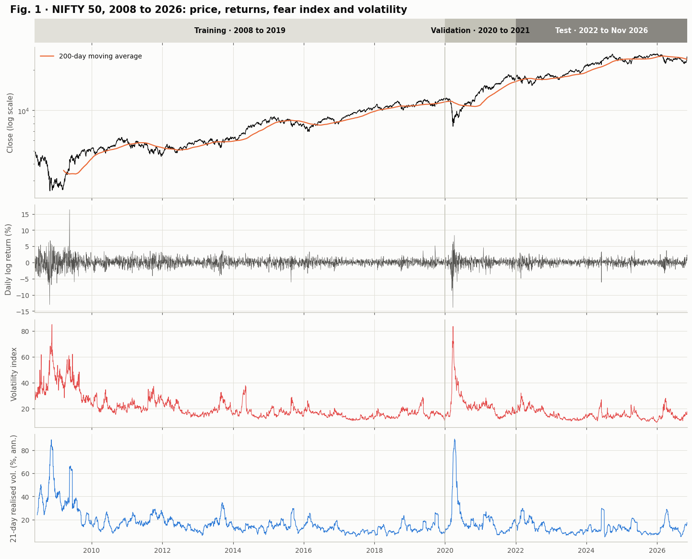

*Figure 1. Market overview: prices, returns and the volatility index.*

**How to read Figure 1.**

* **Top ribbon:** the chronological split. Training (light grey, 2008 to 2019), validation (2020 to 2021) and test (dark, 2022 to November 2026).
* **Price panel (log scale):** on a log scale equal vertical distances mean equal percentage moves. The NIFTY 50 grew from about 2,500 at the 2009 low to about 25,000 in 2026, interrupted by sharp falls: the 2008 crisis, a dip in 2016, and the COVID-19 crash in March 2020, which falls inside the validation period. The orange 200-day moving average shows the long-term trend.
* **Return panel:** daily returns fluctuate around zero with no trend. The largest spikes are the 2008 crisis, May 2009 (a +16 % day after the general-election result) and March 2020. This panel is why the models forecast returns rather than prices: returns are stationary, prices are not.
* **Volatility-index panel (red):** the India VIX, the market's "fear gauge", peaks above 80 in 2008 and again in March 2020.
* **Realised-volatility panel (blue):** the 21-day standard deviation of returns, annualised. It tracks the VIX closely and shows **volatility clustering**: turbulent periods last weeks or months.

### Figure 2 · The stylised facts of returns

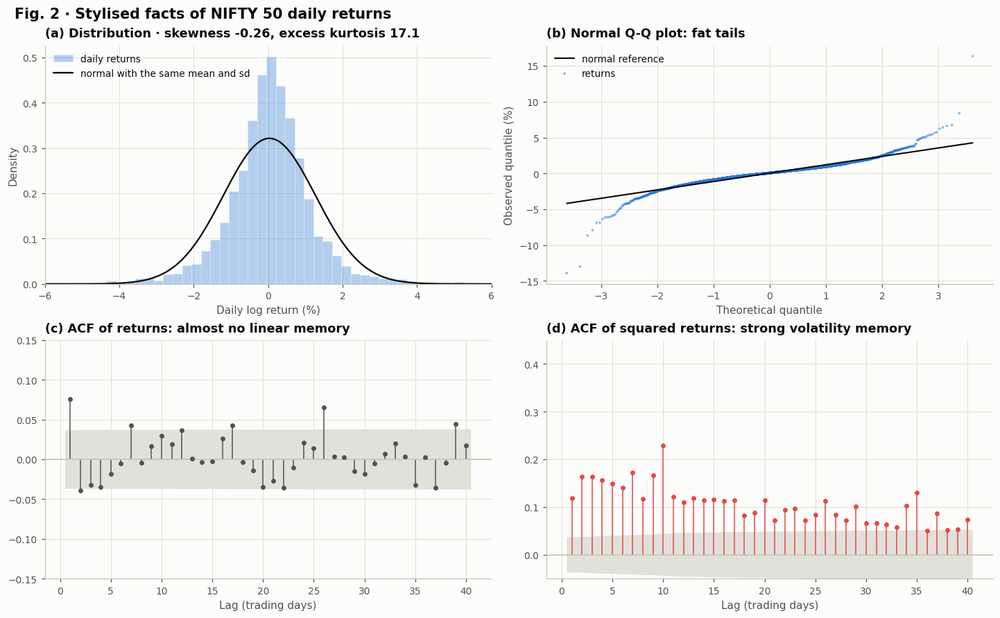

*Figure 2. Stylised facts of daily returns.*

```text
Jarque-Bera normality test: statistic 55,045, p = 0.00e+00
Ljung-Box Q(10) on training returns: 36.6 (p = 0.0001) · on squared returns: 736.6 (p = 8.78e-152)
```

**How to read Figure 2.**

* **(a) Distribution:** the histogram is taller in the middle and heavier in the tails than the normal curve with the same mean and standard deviation. Skewness is -0.26 (crashes are slightly larger than rallies) and the **excess kurtosis is 17.1** (a normal distribution has 0).
* **(b) Q-Q plot:** if returns were normal, the blue points would lie on the black line. They bend away at both ends: extreme days (-14 % and +16 %) are far more extreme than a normal distribution allows.
* **(c) ACF of returns:** almost every bar is inside the grey 95 % band, so returns have almost no linear memory. Only lag 1 (about 0.075) is clearly outside, a small effect that ARIMA will try to use.
* **(d) ACF of squared returns:** every bar is far outside the band and decays slowly. Large moves are followed by large moves: **volatility has long memory**.

**The two printed tests make this formal.** The Jarque-Bera statistic

$$\text{JB} = \frac{n}{6}\left(S^2 + \frac{K^2}{4}\right)$$

uses the skewness $S$ and excess kurtosis $K$; JB = 55,045 with p ≈ 0 rejects normality decisively. The Ljung-Box statistic

$$Q(m) = n(n+2)\sum_{k=1}^{m}\frac{\hat\rho_k^2}{n-k}$$

tests whether the first $m$ autocorrelations are jointly zero. For returns Q(10) = 36.6 (small but significant, p = 0.0001); for squared returns Q(10) = 736.6 (p ≈ 10⁻¹⁵²). Volatility is about **twenty times more predictable** than the direction of returns.

### Figure 3 and Table 3 · Feature correlations and return statistics

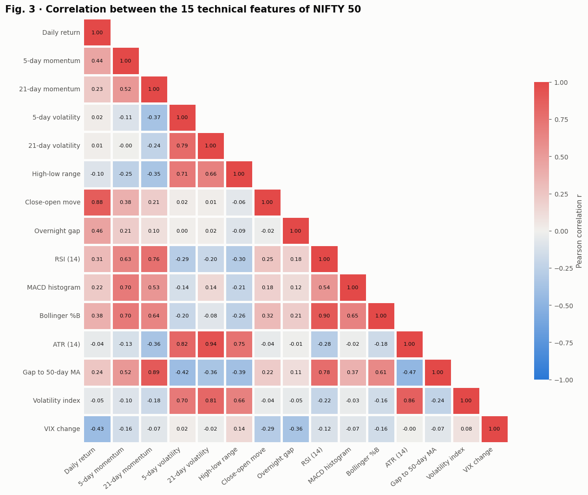

*Figure 3. Feature correlation matrix.*

**How to read Figure 3.** Red means positive and blue negative correlation. Three families stand out:

* **Volatility family:** 21-day volatility, ATR (0.94), high-low range and the volatility index (0.81) move together.
* **Trend family:** RSI and Bollinger %B (0.90), 21-day momentum and the gap to the 50-day average (0.89), MACD.
* **The leverage effect:** the daily return and the VIX change have a correlation of **-0.43**. When the market falls, fear rises. This is one of the best-known facts in finance and it is visible directly in the data.

The daily return itself correlates strongly only with same-day quantities (close-open move 0.88), not with yesterday's features, which is what an efficient market implies.

**Table 3 · Descriptive statistics of daily log returns for all five assets**

|  | Trading days | Mean daily return (%) | Daily volatility (%) | Annualised return (%) | Annualised volatility (%) | Skewness | Excess kurtosis | Worst day (%) | Best day (%) |
|---|---|---|---|---|---|---|---|---|---|
| NIFTY 50 | 4,531 | 0.03 | 1.24 | 8.79 | 19.69 | -0.26 | 17.07 | -13.90 | 16.33 |
| NIFTY Bank | 4,546 | 0.04 | 1.66 | 11.34 | 26.38 | -0.18 | 10.65 | -18.31 | 17.24 |
| Reliance | 4,555 | 0.04 | 1.93 | 8.89 | 30.62 | 0.05 | 9.39 | -17.76 | 19.37 |
| TCS | 4,555 | 0.06 | 1.79 | 15.15 | 28.35 | 0.17 | 6.11 | -10.49 | 14.41 |
| S&P 500 | 4,653 | 0.04 | 1.25 | 9.05 | 19.80 | -0.50 | 13.06 | -12.77 | 10.96 |

**Reading Table 3.** The NIFTY 50 earned about 8.8 % a year with 19.7 % annual volatility over 2008 to 2026. All five assets have fat tails (excess kurtosis from 6 to 17), and the worst single days lost between 10 % and 18 %.

## C.5 Time-series diagnostics: stationarity (notebook Section 5)

**Why it matters.** ARIMA-type models need a **stationary** series: its mean and variance must not drift over time. Two complementary tests are used:

* **ADF (augmented Dickey-Fuller).** It estimates

$$\Delta y_t = \alpha + \gamma\, y_{t-1} + \sum_{j=1}^{p}\delta_j\,\Delta y_{t-j} + e_t$$

and tests $H_0: \gamma = 0$ (a unit root, non-stationary). A small p-value rejects the unit root.

* **KPSS.** It writes $y_t = \xi t + \rho_t + e_t$ with a random walk $\rho_t$ and tests $H_0$: the random walk has zero variance (the series *is* stationary). A small p-value rejects stationarity.

Agreement between the two (ADF rejects, KPSS does not) is strong evidence of stationarity.

**Table 4 · Stationarity tests on the training years (2008 to 2019)**

|  | ADF statistic | ADF p | KPSS level | KPSS level p | KPSS trend | KPSS trend p | Verdict |
|---|---|---|---|---|---|---|---|
| Log price ln P | -0.476 | 0.897 | 8.043 | 0.010 | 0.168 | 0.032 | Unit root, difference once |
| Daily log return r | -28.100 | 0.000 | 0.088 | 0.100 | 0.052 | 0.100 | Stationary |
| Squared return r² | -8.840 | 0.000 | 2.520 | 0.010 | 0.564 | 0.010 | No unit root (ADF); KPSS rejects |

```text
KPSS p-values are interpolated from a look-up table and are capped to the interval [0.01, 0.10].
```

**Reading Table 4.**

* **Log price:** ADF p = 0.897 (cannot reject a unit root) and KPSS rejects stationarity (p = 0.01). The price is a random walk: it must be **differenced once** ($d = 1$).
* **Daily return:** ADF statistic -28.1 (p ≈ 0) and KPSS p = 0.10 (cannot reject stationarity). Returns are stationary. Modelling returns is exactly the "difference once" that ARIMA(p, 1, q) on the log price would do.
* **Squared return:** no unit root, but KPSS rejects level stationarity, because the volatility level shifts slowly between regimes. This is the long memory seen in Figure 2(d).

## C.6 Experimental design and metrics (notebook Section 6)

### The rolling-origin protocol

Every test day $j$ is a forecast **target** at every lead $h = 1, \dots, 20$. The forecast of day $j$ at lead $h$ is issued at the close of day $j - h$, using only information available then. Model parameters are estimated **once** on the training years and then frozen; as new days arrive, models only update their *state*. Every lead is scored on exactly the same 1,197 test days, so differences between leads reflect the lead alone.

The bookkeeping is done by `register` and `by_target`. A model produces a matrix of forecasts with one row per **origin** $i$ and one column per lead $h$. `by_target` re-indexes it so that row $j$ holds the forecasts *of target day* $j$:

$$\text{row of target } j \text{ at lead } h \;=\; j - h - i_0 , \qquad \text{column} = h - 1,$$

where $i_0$ is the first origin.

```python
def make_context(name):
    df, feats, use_volume = DATA[name]
    c = SimpleNamespace(name=name, df=df, feats=feats, use_volume=use_volume)
    c.dates = df.index
    c.close = df["close"].to_numpy()
    c.p = np.log(c.close)
    c.r = feats["ret"].to_numpy()
    c.n = len(c.p)
    c.n_train = int((c.dates <= TRAIN_END).sum())
    c.n_val = int(((c.dates > TRAIN_END) & (c.dates <= VAL_END)).sum())
    c.val_targets = np.arange(c.n_train, c.n_train + c.n_val)
    c.test_targets = np.arange(c.n_train + c.n_val, c.n)
    c.origins = np.arange(c.n_train - H, c.n - 1)
    c.test_dates = c.dates[c.test_targets]
    c.future_index = pd.bdate_range(c.dates[-1] + pd.Timedelta(days=1), periods=H)
    c.mu = float(c.r[:c.n_train].mean())
    c.sigma = float(c.r[:c.n_train].std())
    ahead = np.arange(c.n)[:, None] + LEADS[None, :]
    c.R = np.where(ahead < c.n, c.p[np.minimum(ahead, c.n - 1)] - c.p[:, None], np.nan)
    c.nn_val = np.arange(c.n_train - 1, c.n_train + c.n_val - H)
    c.FC = {}
    return c
```

```python
def by_target(c, paths, targets):
    rows = targets[:, None] - LEADS[None, :] - c.origins[0]
    return paths[rows, LEADS - 1]
```

**Table 5 · Chronological data split**

|  | Period | Trading days | Used for |
|---|---|---|---|
| Training | 20 May 2008 to 31 Dec 2019 | 2,836 | estimating every model parameter |
| Validation | 01 Jan 2020 to 31 Dec 2021 | 498 | hyperparameter selection · early stopping · hybrid weights · interval calibration |
| Test | 03 Jan 2022 to 06 Nov 2026 | 1,197 | final, one-time evaluation: every day is a target at every lead |

### The metrics, and why price errors are misleading

Price-level metrics (RMSE, MAE, MAPE, R² of $\hat P$) are reported because they are familiar, but they cannot separate good from useless models. The reason is simple: with $\hat P_{t+1} = P_t$ the error is $P_{t+1} - P_t \approx P_t r_{t+1}$, which is tiny compared with the variation of the price level over five years, so

$$R^2_{\text{price}} = 1 - \frac{\sum (P_{t+1} - \hat P_{t+1})^2}{\sum (P_{t+1} - \bar P)^2} \approx 1 - \frac{\sigma_r^2\, \bar P^2}{\operatorname{Var}(P)} \approx 0.997$$

even for the random walk. The scientifically meaningful comparison is on **returns**:

| Metric | Formula | Interpretation |
|---|---|---|
| Return RMSE | $\sqrt{\tfrac1n\sum (R - \hat R)^2}$ | typical size of the return error |
| Out-of-sample R² | $R^2_{OS} = 1 - \dfrac{\sum (R - \hat R)^2}{\sum R^2}$ | improvement in squared error over the random walk (which forecasts $\hat R = 0$); above 0 beats it (Campbell & Thompson, 2008) |
| Directional accuracy | $\tfrac1n\sum \mathbf 1\{\operatorname{sign}\hat R = \operatorname{sign} R\}$ | share of correct up or down calls; 50 % is a coin flip |
| Pesaran-Timmermann | see below | is the directional accuracy better than chance? |

**Relation between RMSE reduction and R²_OS.** If the RMSE is reduced by a small fraction $x$, then $\text{MSE}_P = (1 - x)^2 \text{MSE}_{RW}$ and $R^2_{OS} = 1 - (1 - x)^2 \approx 2x$. A 0.18 % RMSE reduction therefore corresponds to a 0.35 % R²_OS, exactly what Tables 14 and 16 show for Hybrid-R.

**The Pesaran-Timmermann test.** Let $\hat p$ be the hit rate, $p_y$ the share of up days and $p_x$ the share of "up" forecasts. If forecasts and outcomes were independent, the expected hit rate would be

$$p_* = p_y p_x + (1 - p_y)(1 - p_x).$$

The statistic $\text{PT} = (\hat p - p_*) / \sqrt{\hat V(\hat p) - \hat V(p_*)}$ is standard normal under independence. It matters because a model that always says "up" in a rising market gets a high hit rate for free; PT corrects for this. If a model *never* changes its call ($p_x = 1$), the variance difference is zero and PT is undefined (shown as n/a).

```python
def return_metrics(actual, predicted):
    e = actual - predicted
    out = {"Return RMSE (%)": 100 * np.sqrt(np.mean(e ** 2)), "Return MAE (%)": 100 * np.mean(np.abs(e)),
           "R²_OS vs random walk (%)": 100 * (1 - np.sum(e ** 2) / np.sum(actual ** 2))}
    moving = predicted != 0
    if moving.mean() > 0.5:
        out["Directional accuracy (%)"] = 100 * np.mean(np.sign(predicted[moving]) == np.sign(actual[moving]))
        out["Pesaran-Timmermann p"] = pesaran_timmermann(actual[moving], predicted[moving])
    else:
        out["Directional accuracy (%)"], out["Pesaran-Timmermann p"] = np.nan, np.nan
    return out
```

```python
def pesaran_timmermann(actual, predicted):
    a, f = actual > 0, predicted > 0
    n = len(a)
    p_hat, py, px = np.mean(a == f), a.mean(), f.mean()
    p_star = py * px + (1 - py) * (1 - px)
    v_hat = p_star * (1 - p_star) / n
    v_star = ((2 * py - 1) ** 2 * px * (1 - px) + (2 * px - 1) ** 2 * py * (1 - py)) / n + 4 * py * px * (1 - py) * (1 - px) / n ** 2
    if v_hat - v_star <= 1e-15:
        return np.nan
    return float(stats.norm.sf((p_hat - p_star) / np.sqrt(v_hat - v_star)))
```

### The two baselines

* **Random walk:** $\hat P_{t+h} = P_t$, so $\hat R_{t,h} = 0$. The efficient-market benchmark.
* **Drift:** $\hat R_{t,h} = h\,\bar r$, where $\bar r$ is the average daily return of the training years. It always predicts "up".

```python
def fit_baselines(c):
    register(c, "Random walk", np.repeat(c.p[c.origins][:, None], H, axis=1), np.full(H, c.p[-1]))
    register(c, "Drift", c.p[c.origins][:, None] + c.mu * LEADS[None, :], c.p[-1] + c.mu * LEADS)
```

```text
Average daily training return +0.0303 % (+7.6 % a year) · daily volatility 1.303 %
```

The average training return was +0.0303 % a day (+7.6 % a year) with a daily volatility of 1.303 %. The volatility is 43 times the mean: the signal-to-noise ratio of daily returns is tiny, which is the core difficulty of the whole problem.


## C.7 ARIMA (notebook Section 7)

### The model

ARIMA(p, 1, q) on the log price is ARMA(p, q) on the daily return:

$$\phi(B)\,(r_t - \mu) = \theta(B)\,\varepsilon_t, \qquad \phi(B) = 1 - \sum_{i=1}^{p}\phi_i B^i,\quad \theta(B) = 1 + \sum_{j=1}^{q}\theta_j B^j,$$

where $B$ is the back-shift operator ($B r_t = r_{t-1}$) and $\varepsilon_t$ is white noise. ARIMA(0, 1, 0) with a mean is exactly the drift model, so ARIMA can only beat drift if returns have usable linear memory.

### Order selection by AIC

All 16 combinations $p, q \in \{0, 1, 2, 3\}$ are fitted by maximum likelihood on the training years and ranked by

$$\text{AIC} = 2k - 2\ln \hat L ,$$

which rewards fit ($\ln \hat L$) but penalises every extra parameter ($k$). The candidates are fitted **in parallel on all CPU cores** (`fit_many`, an engineering optimisation, Part D).

### Exact multi-horizon forecasts from every origin in one pass

A naive implementation would refit or re-run the model at each of the 1,715 forecast origins. Instead the model is written in **state-space form**

$$y_t = x_t'\beta + Z a_t, \qquad a_{t+1} = T a_t + c + R\,\varepsilon_{t+1},$$

and the Kalman filter runs over the full series **once** with the parameters frozen. The filter's one-step predicted state $a_{i+1 \mid i}$ at each origin $i$ is then propagated:

$$a_{i+h \mid i} = T^{\,h-1} a_{i+1 \mid i} + \sum_{k=0}^{h-2} T^{k} c, \qquad \hat r_{i+h \mid i} = x_{i+h}'\beta + Z\, a_{i+h \mid i}.$$

Because future shocks have expectation zero, this is the exact conditional mean. The cumulative sum of the return forecasts gives the log-price forecast, $\ln \hat P_{i+h} = \ln P_i + \sum_{k=1}^{h}\hat r_{i+k \mid i}$. A built-in test (`verify_paths`) recomputes one origin with statsmodels' own `get_forecast()` and stops the notebook if the two differ by more than $10^{-8}$.

```python
def state_space_paths(res, endog, exog, exog_future):
    full = res.apply(endog, exog=exog)
    fr = full.filter_results
    Z, T, c0 = fr.design[:, :, 0], fr.transition[:, :, 0], fr.state_intercept[:, 0]
    m = len(endog)
    A = fr.predicted_state[:, 1:m + 1].copy()
    beta = res.params[list(exog.columns)].to_numpy()
    xb = np.vstack([exog.to_numpy(), exog_future.to_numpy()]) @ beta
    paths = np.empty((m, H))
    for h in range(H):
        paths[:, h] = xb[np.arange(m) + h + 1] + (Z @ A)[0]
        A = T @ A + c0[:, None]
    return paths, full
```

```python
def fit_arima(c):
    statistical_setup(c)
    specs = [((p, 0, q), (0, 0, 0, 0)) for p in range(ARMA_MAX + 1) for q in range(ARMA_MAX + 1)]
    search = aic_search(c.y.iloc[:c.n_train], c.exog.iloc[:c.n_train], specs)
    c.arima_res = search.loc[0, "result"]
    c.arima_order = (int(search.loc[0, "p"]), 1, int(search.loc[0, "q"]))
    search = search.drop(columns="result")
    c.F_arima, c.arima_full = state_space_paths(c.arima_res, c.y, c.exog, c.exog_future)
    c.arima_gap = verify_paths(c, c.arima_res, c.F_arima, c.y, c.exog, c.exog_future)
    register_returns_model(c, "ARIMA", c.F_arima)
    return search
```

**Output.**

```text
Searched 16 candidate models in 15.5 s, ARIMA(2, 1, 1) selected
Vectorised forecasts match statsmodels get_forecast() exactly (max |difference| = 0.0e+00)
```

**Table 6 · ARIMA candidates for daily returns ranked by AIC (top 5)**

| p | q | AIC | BIC | ΔAIC | converged |
|---|---|---|---|---|---|
| 2 | 1 | -16587.2 | -16557.4 | 0.0 | True |
| 2 | 0 | -16585.5 | -16561.7 | 1.7 | True |
| 3 | 0 | -16585.3 | -16555.5 | 1.9 | True |
| 0 | 3 | -16585.1 | -16555.3 | 2.1 | True |
| 0 | 2 | -16584.8 | -16561.0 | 2.4 | True |

**Table 7 · ARIMA(2, 1, 1) parameter estimates (training years)**

|  | estimate | std. error | z | p-value |
|---|---|---|---|---|
| mean | 0.00030 | 0.00025 | 1.20324 | 0.22889 |
| ar.L1 | 0.63395 | 0.13399 | 4.73146 | 0.00000 |
| ar.L2 | -0.08818 | 0.01203 | -7.33289 | 0.00000 |
| ma.L1 | -0.55542 | 0.13492 | -4.11671 | 0.00004 |
| sigma2 | 0.00017 | 0.00000 | 103.64280 | 0.00000 |

**Reading the ARIMA output.**

* The fast vectorised forecasts match statsmodels **exactly** (difference 0.0), so the speed-up is free of error.
* AIC selects ARIMA(2, 1, 1), but the top five candidates are within 2.4 AIC points: the data barely distinguish them, a sign of weak structure.
* The coefficients look strongly significant (AR 0.634 and -0.088, MA -0.555), but notice that the AR and MA terms almost cancel: $\phi(B) \approx \theta(B)$ near the first lag. Such near-cancelling roots are the classic signature of a model fitting noise. The out-of-sample results confirm it: ARIMA is the worst model on the test period (R²_OS -1.51 %, Section C.13).

## C.8 SARIMA with a weekly trading cycle (notebook Section 8)

### The model

Calendar effects such as the day-of-the-week effect (French, 1980) suggest returns might depend on the position in the trading week. SARIMA adds seasonal polynomials at period $s = 5$:

$$\phi(B)\,\Phi(B^5)\,(r_t - \mu) = \theta(B)\,\Theta(B^5)\,\varepsilon_t .$$

### Selection on the validation years instead of AIC

AIC measures fit on the *training* years. For daily returns that is dangerous: the small autocorrelations of 2008 to 2019 need not persist. SARIMA, the linear base of both hybrids, is therefore selected like every neural hyperparameter: each of the 27 candidates ($p, q \le 2$, $P, Q \le 1$, at least one seasonal term) is fitted on the training years and scored by its **one-step forecast RMSE on the validation years** with parameters frozen:

$$\text{RMSE}_{\text{val}} = \sqrt{\frac{1}{n_{\text{val}}}\sum_{t \in \text{val}}\big(r_t - \hat r_{t \mid t-1}\big)^2 } .$$

ARIMA keeps the classical AIC rule, so the two procedures can be compared directly.

```python
def fit_sarima(c):
    specs = [((p, 0, q), (P, 0, Q, SEASONAL_PERIOD)) for p in range(SARIMA_MAX + 1) for q in range(SARIMA_MAX + 1)
             for P in (0, 1) for Q in (0, 1) if P + Q > 0]
    search = aic_search(c.y.iloc[:c.n_train], c.exog.iloc[:c.n_train], specs)
    val = slice(c.n_train, c.n_train + c.n_val)
    search["Validation RMSE (%)"] = [100 * np.sqrt(np.mean((c.r[val] - res.apply(c.y, exog=c.exog).fittedvalues.to_numpy()[val]) ** 2))
                                     for res in search["result"]]
    search = search.sort_values(["converged", "Validation RMSE (%)"], ascending=[False, True]).reset_index(drop=True)
    c.sarima_res = search.loc[0, "result"]
    c.sarima_order = (int(search.loc[0, "p"]), 1, int(search.loc[0, "q"]))
    search = search.drop(columns="result")
    c.seasonal_order = (int(search.loc[0, "P"]), 0, int(search.loc[0, "Q"]), SEASONAL_PERIOD)
    c.F_sarima, c.sarima_full = state_space_paths(c.sarima_res, c.y, c.exog, c.exog_future)
    c.sarima_gap = verify_paths(c, c.sarima_res, c.F_sarima, c.y, c.exog, c.exog_future)
    c.sarima_logp = register_returns_model(c, "SARIMA", c.F_sarima)
    res = c.sarima_res
    ar = np.convolve(lag_polynomial(res.arparams, 1, -1), lag_polynomial(res.seasonalarparams, SEASONAL_PERIOD, -1))
    ma = np.convolve(lag_polynomial(res.maparams, 1, 1), lag_polynomial(res.seasonalmaparams, SEASONAL_PERIOD, 1))
    c.psi = arma2ma(ar, ma, lags=H)
    c.cum_psi = np.cumsum(c.psi)
    c.innovations = c.sarima_full.resid.to_numpy()
    return search
```

**Output.**

```text
Searched 27 candidate models in 33.8 s, SARIMA(0, 1, 0)(1, 0, 1, 5) selected
Vectorised forecasts match statsmodels get_forecast() exactly (max |difference| = 0.0e+00)
AIC: ARIMA -16587.2 · SARIMA -16564.4 · difference +22.8 (no meaningful weekly effect)
One-step validation RMSE: selected SARIMA 1.5851 % · AIC-best SARIMA candidate 1.6110 %
```

**Table 8 · SARIMA candidates ranked by one-step RMSE on the validation years (top 5; AIC shown for reference)**

| p | q | P | Q | AIC | BIC | ΔAIC | converged | Validation RMSE (%) |
|---|---|---|---|---|---|---|---|---|
| 0 | 0 | 1 | 1 | -16564.4 | -16540.6 | 20.5 | True | 1.5851 |
| 0 | 0 | 1 | 0 | -16566.1 | -16548.2 | 18.9 | True | 1.5855 |
| 0 | 0 | 0 | 1 | -16566.0 | -16548.1 | 18.9 | True | 1.5855 |
| 2 | 2 | 1 | 0 | -16577.5 | -16535.9 | 7.4 | True | 1.5996 |
| 1 | 0 | 1 | 1 | -16578.5 | -16548.8 | 6.4 | True | 1.6011 |

**Table 9 · SARIMA parameter estimates (training years)**

|  | estimate | std. error | z | p-value |
|---|---|---|---|---|
| mean | 0.00030 | 0.00025 | 1.20965 | 0.22641 |
| ar.S.L5 | -0.14862 | 0.54268 | -0.27387 | 0.78419 |
| ma.S.L5 | 0.13060 | 0.54327 | 0.24039 | 0.81003 |
| sigma2 | 0.00017 | 0.00000 | 97.46195 | 0.00000 |

**Reading the SARIMA output.**

* Validation selects SARIMA(0, 1, 0)(1, 0, 1)₅: **no non-seasonal ARMA terms at all**, only a weekly AR and MA term that are not significant (p = 0.78 and 0.81) and nearly cancel each other. In plain words: on unseen data the best linear model is almost "returns are noise around a small mean".
* Its validation RMSE (1.5851 %) beats the AIC-best candidate (1.6110 %). On the test period this choice turns a model that lost to the random walk into one that beats it (R²_OS +0.20 % instead of -1.43 % in the earlier run, Part D). This is the clearest lesson of the project: **choose models by out-of-sample error, not by in-sample fit.**
* The AIC of the selected SARIMA is 22.8 points worse than ARIMA's, which proves that AIC and out-of-sample accuracy can disagree.

## C.9 GARCH(1,1): forecasting volatility (notebook Section 9)

### The model

The SARIMA innovations $\varepsilon_t$ are modelled as $\varepsilon_t = \sigma_t z_t$ with $z_t$ i.i.d. (mean 0, variance 1) and

$$\sigma_t^2 = \omega + \alpha\,\varepsilon_{t-1}^2 + \beta\,\sigma_{t-1}^2, \qquad \omega > 0,\ \alpha, \beta \ge 0,\ \alpha + \beta < 1$$

(Bollerslev, 1986). A large surprise yesterday ($\alpha$) raises today's variance, and the variance decays slowly ($\beta$).

### Estimation

The parameters maximise the Gaussian quasi-likelihood on the training years:

$$\ln L(\omega, \alpha, \beta) = -\tfrac12 \sum_t \left(\ln \sigma_t^2 + \frac{\varepsilon_t^2}{\sigma_t^2}\right).$$

To keep the constraints satisfied automatically, the optimiser works on unconstrained numbers $\theta$:

$$\omega = e^{\theta_0}, \qquad \alpha + \beta = \text{sigmoid}(\theta_1) < 1, \qquad \frac{\alpha}{\alpha + \beta} = \text{sigmoid}(\theta_2).$$

The variance recursion is a linear filter, computed with `scipy.signal.lfilter`, so the likelihood can be evaluated thousands of times in seconds.

### Derivation of the multi-step forecast

Let $\bar\sigma^2 = \omega / (1 - \alpha - \beta)$ be the long-run variance. Taking expectations at time $t$ and using $\mathbb E_t[\varepsilon_{t+k}^2] = \mathbb E_t[\sigma_{t+k}^2]$ for $k \ge 1$:

$$\mathbb E_t[\sigma_{t+k+1}^2] = \omega + (\alpha + \beta)\,\mathbb E_t[\sigma_{t+k}^2].$$

Subtracting $\bar\sigma^2 = \omega + (\alpha + \beta)\bar\sigma^2$ from both sides gives $\mathbb E_t[\sigma_{t+k+1}^2] - \bar\sigma^2 = (\alpha + \beta)\big(\mathbb E_t[\sigma_{t+k}^2] - \bar\sigma^2\big)$, and by induction

$$\boxed{\ \sigma^2_{t+h \mid t} = \bar\sigma^2 + (\alpha + \beta)^{h-1}\big(\sigma^2_{t+1 \mid t} - \bar\sigma^2\big)\ }$$

The gap to the long-run level shrinks by the factor $\alpha + \beta$ every day, so the **half-life** of a volatility shock solves $(\alpha + \beta)^{h} = \tfrac12$:

$$h_{1/2} = \frac{\ln 0.5}{\ln(\alpha + \beta)} .$$

Because daily returns are nearly uncorrelated, the variance of the cumulative return over $h$ days is approximately the sum $\hat s_{t,h}^2 = \sum_{k=1}^{h}\sigma^2_{t+k \mid t}$. Its square root `garch_cumsd` scales both the neural-network targets (Section C.10) and the prediction intervals (Section C.14).

```python
def fit_garch(c):
    e = np.nan_to_num(c.innovations)
    train = e[1:c.n_train]
    s0 = float(train.var())

    def negative_loglik(theta):
        omega, alpha, beta = garch_params(theta)
        s2 = garch_filter(train, omega, alpha, beta, s0)
        return 0.5 * np.sum(np.log(s2) + train ** 2 / s2)

    start = np.array([np.log(s0 * 0.03), np.log(0.97 / 0.03), np.log((0.08 / 0.97) / (1 - 0.08 / 0.97))])
    result = minimize(negative_loglik, start, method="Nelder-Mead", options={"maxiter": 5000, "xatol": 1e-8, "fatol": 1e-8})
    omega, alpha, beta = garch_params(result.x)
    s2 = garch_filter(e, omega, alpha, beta, s0)
    c.garch = {"omega": omega, "alpha": alpha, "beta": beta, "converged": bool(result.success)}
    c.garch_s2 = s2
    c.garch_v1 = omega + alpha * e ** 2 + beta * s2
    long_run = omega / (1 - alpha - beta)
    variance = long_run + (alpha + beta) ** (LEADS - 1)[None, :] * (c.garch_v1[:, None] - long_run)
    c.garch_cumsd = np.sqrt(np.cumsum(variance, axis=1))
    return pd.DataFrame({"estimate": [omega, alpha, beta, alpha + beta, np.log(0.5) / np.log(alpha + beta),
                                      100 * np.sqrt(TRADING_DAYS * long_run)]},
                        index=["ω", "α (reaction to news)", "β (memory)", "persistence α + β", "half-life of a shock (days)",
                               "long-run volatility (%, annualised)"])
```

**Output.**

**Table 10 · GARCH(1,1) estimates on SARIMA innovations (training years, converged: True)**

|  | estimate |
|---|---|
| ω | 1.07223e-06 |
| α (reaction to news) | 0.0727235 |
| β (memory) | 0.921263 |
| persistence α + β | 0.993987 |
| half-life of a shock (days) | 114.92 |
| long-run volatility (%, annualised) | 21.1974 |

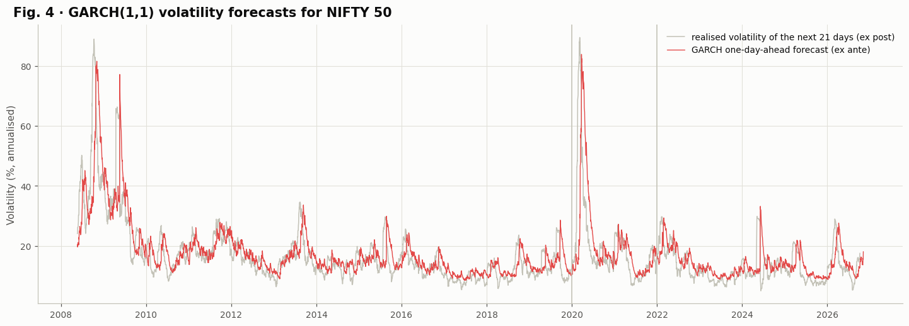

*Figure 4. GARCH(1,1) conditional volatility.*

**Reading Table 10 and Figure 4.**

* $\alpha = 0.073$ (reaction to news) and $\beta = 0.921$ (memory) give a **persistence of 0.994**: a volatility shock fades with a half-life of $\ln 0.5 / \ln 0.994 \approx 115$ trading days, almost half a year.
* The long-run volatility is 21.2 % a year, close to the 19.7 % measured in Table 3.
* In Figure 4 the red GARCH forecast (made each evening for the next day) rises within days of every shock and decays as calm returns. It tracks the grey line, the volatility realised over the *next* 21 days, which the model never saw. The two big spikes are October 2008 and March 2020.

## C.10 LSTM: a multi-feature recurrent network (notebook Section 10)

### Why an LSTM, and the equations

A Long Short-Term Memory network (Hochreiter & Schmidhuber, 1997) reads a window of past days one at a time and keeps a cell state $c_t$ controlled by three gates:

$$
\begin{aligned}
f_t &= \sigma(W_f[h_{t-1}, x_t] + b_f) && \text{forget gate}\\
i_t &= \sigma(W_i[h_{t-1}, x_t] + b_i) && \text{input gate}\\
o_t &= \sigma(W_o[h_{t-1}, x_t] + b_o) && \text{output gate}\\
c_t &= f_t \odot c_{t-1} + i_t \odot \tanh(W_c[h_{t-1}, x_t] + b_c) && \text{cell update}\\
h_t &= o_t \odot \tanh(c_t) && \text{hidden state}
\end{aligned}
$$

The additive cell update lets gradients survive across many days, so the network can learn non-linear interactions between momentum, volatility and fear that a linear model cannot represent.

### Architecture and parameter count

For an LSTM layer with $u$ units and $d$ inputs, each of the four gates has a weight matrix of size $u \times (u + d)$ and a bias of size $u$, so it has

$$4\,\big[u(u + d) + u\big] \text{ parameters.}$$

For the configuration selected on the NIFTY 50 (look-back 20 days, units 128 and 64, $d = 15$ features, 20 outputs):

| Layer | Computation | Parameters |
|---|---|---|
| LSTM 1 (128 units, input 15) | $4[128(128 + 15) + 128]$ | 73,728 |
| Dropout 0.3 | | 0 |
| LSTM 2 (64 units, input 128) | $4[64(64 + 128) + 64]$ | 49,408 |
| Dropout 0.3 | | 0 |
| Dense 32, ReLU | $64 \cdot 32 + 32$ | 2,080 |
| Dense 20, linear (output) | $32 \cdot 20 + 20$ | 660 |
| **Total per network** | | **125,876** |

The ensemble of three networks therefore has 377,628 parameters, exactly the number reported in the cost table (Table 25). The calculation is a useful check that the model is what we think it is.

### Three design choices that make the LSTM honest

**1. Direct multi-horizon output.** The network outputs all 20 cumulative returns $R_{t,1}, \dots, R_{t,20}$ at once. Recursive forecasting (feeding predictions back in) is impossible here because features such as the VIX cannot be forecast, and a direct output avoids error accumulation.

**2. GARCH-scaled targets.** The targets are divided by GARCH's forecast standard deviation:

$$y_{t,h} = \frac{R_{t,h}}{\hat s_{t,h}} .$$

Without this, a handful of crash days in March 2020 would dominate every validation error. Scaling removes the effect of volatility itself, so that a 3 % move on a calm day and a 10 % move on a crash day count comparably, and the forecast is multiplied back: $\hat R_{t,h} = \hat y_{t,h}\,\hat s_{t,h}$. Scaling cannot remove the unusually strong and persistent rally that followed the crash: the scaled validation targets still have a mean square of about 1.8 (the validation losses printed below), which is why the learning curves in Figure 5 are drawn relative to the random walk on the same windows.

**3. A random-walk start.** The output layer is initialised to zero. Before training the network outputs $\hat y = 0$, which is exactly the random walk. Training moves it away from the random walk only as far as the data support. With early stopping (Section below), a network that finds nothing useful stays close to the random walk instead of producing noise.

```python
def build_lstm(n_features, n_outputs, cfg, seed, name):
    keras.utils.set_random_seed(seed)
    inputs = keras.Input(shape=(cfg["lookback"], n_features), name="market_window")
    x = keras.layers.LSTM(cfg["units"][0], return_sequences=True, name="lstm_1")(inputs)
    x = keras.layers.Dropout(cfg["dropout"], name="dropout_1")(x)
    x = keras.layers.LSTM(cfg["units"][1], name="lstm_2")(x)
    x = keras.layers.Dropout(cfg["dropout"], name="dropout_2")(x)
    x = keras.layers.Dense(32, activation="relu", name="dense_32")(x)
    outputs = keras.layers.Dense(n_outputs, kernel_initializer="zeros", bias_initializer="zeros", name="scaled_returns")(x)
    model = keras.Model(inputs, outputs, name=name)
    model.compile(optimizer=keras.optimizers.Adam(learning_rate=cfg["learning_rate"]), loss="mse")
    return model
```

```python
def fit_network(c, X, target_fn, cfg, seed, name, patience=15):
    X_tr, Y_tr = windows(X, c.nn_train, cfg["lookback"]), target_fn(c.nn_train)
    X_va, Y_va = windows(X, c.nn_val, cfg["lookback"]), target_fn(c.nn_val)
    model = build_lstm(X.shape[1], Y_tr.shape[1], cfg, seed, name)
    history = model.fit(X_tr, Y_tr, validation_data=(X_va, Y_va), epochs=MAX_EPOCHS, batch_size=cfg["batch_size"], verbose=0,
                        callbacks=[keras.callbacks.EarlyStopping(patience=patience, restore_best_weights=True),
                                   keras.callbacks.ReduceLROnPlateau(factor=0.5, patience=5, min_lr=1e-5)]).history
    history["rw_loss"], history["rw_val_loss"] = float(np.mean(Y_tr ** 2)), float(np.mean(Y_va ** 2))
    return model, history
```

```text
Training windows 2,757 · validation windows 479 · features 15 · outputs 20
```

### Hyperparameter optimisation by random search

The search space has $3^5 = 243$ combinations (look-back, layer sizes, dropout, learning rate, batch size). A full grid would need 243 networks per asset. **Random search** (Bergstra & Bengio, 2012) samples 10 distinct configurations; because only a few hyperparameters usually matter, it finds settings as good as a grid at a fraction of the cost. The first trial is always the default configuration, so the search can never end up worse than the default.

Each trial is scored by the **validation MSE ratio against the random walk**, averaged over the 20 leads:

$$\text{ratio} = \frac{1}{20}\sum_{h=1}^{20} \frac{\sum_{t \in \text{val}} (y_{t,h} - \hat y_{t,h})^2}{\sum_{t \in \text{val}} y_{t,h}^2}, \qquad \text{ratio} < 1 \iff \text{better than the random walk.}$$

```python
def tune_lstm(c, verbose=True):
    configs = sample_configs(LSTM_SPACE, LSTM_TRIALS, LSTM_DEFAULT, SEED)
    truth = lstm_targets(c, c.nn_val)
    rows = []
    for i, cfg in enumerate(configs):
        start = time.time()
        model, hist = fit_network(c, c.X_all, lambda o: lstm_targets(c, o), cfg, SEED, f"lstm_trial_{i + 1}", patience=10)
        pred = np.asarray(model.predict(windows(c.X_all, c.nn_val, cfg["lookback"]), verbose=0, batch_size=2048))
        rows.append({"Trial": i + 1, **format_cfg(cfg), "Epochs": len(hist["loss"]),
                     "Validation MSE ratio vs random walk": mse_ratio(truth, pred), "Time (s)": time.time() - start})
        del model
        gc.collect()
        if verbose:
            print(f"  trial {i + 1:>2}/{len(configs)} · {format_cfg(cfg)} · MSE ratio {rows[-1]['Validation MSE ratio vs random walk']:.4f}")
    table = pd.DataFrame(rows)
    c.lstm_cfg = configs[int(table["Validation MSE ratio vs random walk"].idxmin())]
    return table.sort_values("Validation MSE ratio vs random walk").reset_index(drop=True)
```

**Output.**

```text
  trial  1/10 · {'lookback': 20, 'units': '64 / 32', 'dropout': 0.3, 'learning_rate': 0.0003, 'batch_size': 64} · MSE ratio 0.9991
  trial  2/10 · {'lookback': 20, 'units': '128 / 64', 'dropout': 0.3, 'learning_rate': 0.0001, 'batch_size': 64} · MSE ratio 0.9937
  trial  3/10 · {'lookback': 20, 'units': '128 / 64', 'dropout': 0.2, 'learning_rate': 0.0003, 'batch_size': 32} · MSE ratio 1.0097
  trial  4/10 · {'lookback': 10, 'units': '64 / 32', 'dropout': 0.5, 'learning_rate': 0.001, 'batch_size': 32} · MSE ratio 1.0045
  trial  5/10 · {'lookback': 20, 'units': '128 / 64', 'dropout': 0.5, 'learning_rate': 0.0003, 'batch_size': 128} · MSE ratio 0.9966
  trial  6/10 · {'lookback': 60, 'units': '32 / 16', 'dropout': 0.3, 'learning_rate': 0.0001, 'batch_size': 128} · MSE ratio 0.9954
  trial  7/10 · {'lookback': 10, 'units': '32 / 16', 'dropout': 0.2, 'learning_rate': 0.0003, 'batch_size': 32} · MSE ratio 0.9962
  trial  8/10 · {'lookback': 20, 'units': '64 / 32', 'dropout': 0.5, 'learning_rate': 0.001, 'batch_size': 128} · MSE ratio 0.9982
  trial  9/10 · {'lookback': 60, 'units': '32 / 16', 'dropout': 0.2, 'learning_rate': 0.001, 'batch_size': 64} · MSE ratio 1.0083
  trial 10/10 · {'lookback': 60, 'units': '128 / 64', 'dropout': 0.5, 'learning_rate': 0.0001, 'batch_size': 32} · MSE ratio 0.9987
10 configurations trained in 111 s, selected: {'lookback': 20, 'units': '128 / 64', 'dropout': 0.3, 'learning_rate': 0.0001, 'batch_size': 64}
```

**Table 11 · LSTM random search on the validation years, best first (one seed each)**

| Trial | lookback | units | dropout | learning_rate | batch_size | Epochs | Validation MSE ratio vs random walk | Time (s) |
|---|---|---|---|---|---|---|---|---|
| 2 | 20 | 128 / 64 | 0.3 | 1e-04 | 64 | 13 | 0.9937 | 9 |
| 6 | 60 | 32 / 16 | 0.3 | 1e-04 | 128 | 15 | 0.9954 | 7 |
| 7 | 10 | 32 / 16 | 0.2 | 3e-04 | 32 | 11 | 0.9962 | 11 |
| 5 | 20 | 128 / 64 | 0.5 | 3e-04 | 128 | 12 | 0.9966 | 11 |
| 8 | 20 | 64 / 32 | 0.5 | 1e-03 | 128 | 11 | 0.9982 | 6 |
| 10 | 60 | 128 / 64 | 0.5 | 1e-04 | 32 | 11 | 0.9987 | 17 |
| 1 | 20 | 64 / 32 | 0.3 | 3e-04 | 64 | 11 | 0.9991 | 13 |
| 4 | 10 | 64 / 32 | 0.5 | 1e-03 | 32 | 13 | 1.0045 | 13 |
| 9 | 60 | 32 / 16 | 0.2 | 1e-03 | 64 | 11 | 1.0083 | 8 |
| 3 | 20 | 128 / 64 | 0.2 | 3e-04 | 32 | 12 | 1.0097 | 13 |

**Reading Table 11.** Seven of the ten configurations beat the random walk on the validation years (ratio below 1). The best (trial 2: look-back 20 days, 128 and 64 units, dropout 0.3, learning rate 0.0001, batch 64) reduces the validation error by 0.63 %. The two best configurations used the smallest learning rate (0.0001); the three that lost to the random walk combined the largest learning rate (0.001), or low dropout with small batches, the settings that let a network chase noise fastest. Every trial stopped after 11 to 15 epochs: on market data the useful learning happens in the first few epochs.

### Ensemble training

Three networks with the selected configuration and seeds 42, 43 and 44 are trained, and their forecasts are averaged. Averaging independent networks reduces variance (Lakshminarayanan et al., 2017).

```text
  lstm · member 1/3: best epoch   3 of 18, validation loss 1.8381  (11 s)
  lstm · member 2/3: best epoch   1 of 16, validation loss 1.8499  (9 s)
  lstm · member 3/3: best epoch   1 of 16, validation loss 1.8494  (10 s)
Trained and forecast from 1,715 origins in 30 s
```

Two of the three networks found their best validation loss at epoch 1 and one at epoch 3. This is not a failure: thanks to the random-walk start, "best at epoch 1" means the network stays very close to the random walk, which is the correct behaviour when daily returns contain little learnable structure.

## C.11 N-BEATS: a modern deep-learning baseline (notebook Section 11)

### The model

N-BEATS (Oreshkin et al., 2020) beat the winner of the M4 forecasting competition with a pure deep-learning architecture. It stacks fully connected blocks with **doubly residual** connections. Block $b$ receives the part of the input the earlier blocks could not explain, and produces a *backcast* (its reconstruction of the input) and a *forecast*:

$$x^{(b+1)} = x^{(b)} - \hat x^{(b)}_{\text{back}}, \qquad \hat y = \sum_{b=1}^{B}\hat y^{(b)}_{\text{fore}} .$$

Here the input is a window of past daily returns, each divided by GARCH's volatility for that day (so the input is free of volatility clustering), the output is the same 20 GARCH-scaled cumulative returns as the LSTM, and the forecast heads are initialised to zero (a random-walk start). Three blocks of four dense layers with 128 ReLU units are used.

### Parameter count, and a small puzzle

For the selected look-back of 120 days, one block has

$$\underbrace{(120 \cdot 128 + 128)}_{\text{first layer}} + \underbrace{3(128 \cdot 128 + 128)}_{\text{three hidden layers}} + \underbrace{(128 \cdot 120 + 120)}_{\text{backcast}} + \underbrace{(128 \cdot 20 + 20)}_{\text{forecast}} = 83{,}084$$

parameters, so three blocks would have 249,252. The run reports **233,772**. The difference, 15,480, is exactly one backcast layer: the last block's backcast is never used to produce the forecast, so Keras removes it from the model graph. The count confirms that the architecture was built exactly as designed.

```python
def build_nbeats(cfg, seed, name):
    keras.utils.set_random_seed(seed)
    inputs = keras.Input(shape=(cfg["lookback"],), name="return_history")
    residual, forecast = inputs, None
    for b in range(NB_BLOCKS):
        x = residual
        for layer in range(4):
            x = keras.layers.Dense(NB_UNITS, activation="relu", name=f"block{b + 1}_fc{layer + 1}")(x)
            x = keras.layers.Dropout(cfg["dropout"], name=f"block{b + 1}_dropout{layer + 1}")(x)
        backcast = keras.layers.Dense(cfg["lookback"], name=f"block{b + 1}_backcast")(x)
        block_forecast = keras.layers.Dense(H, kernel_initializer="zeros", bias_initializer="zeros", name=f"block{b + 1}_forecast")(x)
        residual = keras.layers.Subtract(name=f"block{b + 1}_residual")([residual, backcast])
        forecast = block_forecast if forecast is None else keras.layers.Add(name=f"block{b + 1}_sum")([forecast, block_forecast])
    model = keras.Model(inputs, forecast, name=name)
    model.compile(optimizer=keras.optimizers.Adam(learning_rate=cfg["learning_rate"]), loss="mse")
    return model
```

**Output.**

```text
  trial 1/5 · {'lookback': 60, 'dropout': 0.1, 'learning_rate': 0.0001} · MSE ratio 0.9901
  trial 2/5 · {'lookback': 20, 'dropout': 0.1, 'learning_rate': 0.0001} · MSE ratio 0.9948
  trial 3/5 · {'lookback': 60, 'dropout': 0.3, 'learning_rate': 0.0003} · MSE ratio 0.9905
  trial 4/5 · {'lookback': 60, 'dropout': 0.3, 'learning_rate': 0.0001} · MSE ratio 0.9910
  trial 5/5 · {'lookback': 120, 'dropout': 0.1, 'learning_rate': 0.0003} · MSE ratio 0.9870
5 configurations trained in 102 s, selected: {'lookback': 120, 'dropout': 0.1, 'learning_rate': 0.0003}
```

**Table 12 · N-BEATS random search on the validation years, best first (one seed each)**

| Trial | lookback | dropout | learning_rate | Epochs | Validation MSE ratio vs random walk | Time (s) |
|---|---|---|---|---|---|---|
| 5 | 120 | 0.1 | 3e-04 | 11 | 0.9870 | 20 |
| 1 | 60 | 0.1 | 1e-04 | 12 | 0.9901 | 22 |
| 3 | 60 | 0.3 | 3e-04 | 11 | 0.9905 | 19 |
| 4 | 60 | 0.3 | 1e-04 | 12 | 0.9910 | 19 |
| 2 | 20 | 0.1 | 1e-04 | 12 | 0.9948 | 20 |

```text
  nbeats · member 1/3: best epoch   1 of 16, validation loss 1.8268  (20 s)
  nbeats · member 2/3: best epoch   1 of 16, validation loss 1.8219  (20 s)
  nbeats · member 3/3: best epoch   1 of 16, validation loss 1.8278  (20 s)
N-BEATS ensemble trained and forecast in 60 s · 233,772 parameters per member
```

**Reading Table 12.** All five N-BEATS configurations beat the random walk on the validation years (ratios 0.987 to 0.995), slightly better than the best LSTM. The longest look-back (120 days) with the larger learning rate won.

## C.12 Hybrid models (notebook Section 12)

### The idea (Zhang, 2003)

A real series can be split into a **linear** part $L_t$ and a **non-linear** part $N_t$:

$$y_t = L_t + N_t .$$

A statistical model captures $L_t$ well but cannot represent $N_t$; a neural network can learn $N_t$ but wastes capacity on $L_t$. A hybrid assigns each part to the model built for it.

### Hybrid-R: SARIMA plus an LSTM residual learner (the proposed model)

1. SARIMA forecasts the linear part. Its one-step error $e_{t+1} = r_{t+1} - \hat r^{\,\text{SARIMA}}_{t+1 \mid t}$ contains whatever the linear model missed.
2. An LSTM (with the configuration selected in Section C.10) learns to predict that error, divided by GARCH volatility: $\hat z_{t+1} \approx e_{t+1} / \sigma_{t+1 \mid t}$. Its inputs are the 15 features plus SARIMA's recent scaled errors. Because the errors are almost white noise, the network also predicts the scaled cumulative returns at leads 2 to 20 as **auxiliary tasks** (multi-task learning), which gives it a denser training signal.
3. The day-ahead correction is $\hat e_{t+1} = \hat z_{t+1}\,\sigma_{t+1 \mid t}$.

### Derivation of the ψ-weight propagation

How should tomorrow's correction affect the forecasts for later days? Write SARIMA in its infinite moving-average form:

$$r_t - \mu = \sum_{k=0}^{\infty}\psi_k\,\varepsilon_{t-k}, \qquad \psi(B) = \frac{\theta(B)\Theta(B^5)}{\phi(B)\Phi(B^5)}, \quad \psi_0 = 1 .$$

If tomorrow's shock is not zero (as SARIMA assumes) but $\hat e_{t+1}$, then the return $k$ days after tomorrow changes by $\psi_k \hat e_{t+1}$. The log price is the cumulative sum of returns, so the change in the $h$-day log-price forecast is

$$\Delta \ln \hat P_{t+h} = \sum_{k=1}^{h} \psi_{k-1}\,\hat e_{t+1} = \hat e_{t+1}\sum_{k=0}^{h-1}\psi_k ,$$

which gives the Hybrid-R forecast

$$\boxed{\ \ln \hat P^{\,\text{HR}}_{t+h \mid t} = \ln \hat P^{\,\text{SARIMA}}_{t+h \mid t} + \hat e_{t+1}\sum_{k=0}^{h-1}\psi_k\ }$$

This is the forecast SARIMA itself would issue if it were told tomorrow's shock. The correction therefore follows SARIMA's own dynamics and can never make the hybrid drift away at long horizons. The ψ-weights are computed from the full lag polynomials, including the weekly terms.

```python
def fit_hybrid_r(c, verbose=True):
    z = (np.nan_to_num(c.innovations) / np.sqrt(c.garch_s2)).astype("float32")
    c.X_res = np.concatenate([c.X_all, z[:, None]], axis=1).astype("float32")

    def residual_targets(origins):
        targets = c.R_scaled[origins].copy()
        targets[:, 0] = z[origins + 1]
        return targets.astype("float32")

    c.residual_members, c.residual_histories = train_ensemble(c, c.X_res, residual_targets, "residual_lstm", verbose)
    all_origins = np.append(c.origins, c.n - 1)
    correction = ensemble_predict(c.residual_members, c.X_res, all_origins, c.lstm_cfg["lookback"])[:, 0] * np.sqrt(c.garch_v1[all_origins])
    c.hybrid_correction = correction
    paths = c.sarima_logp[all_origins] + correction[:, None] * c.cum_psi[None, :]
    register(c, "Hybrid-R", paths[:-1], paths[-1])
```

```text
  residual_lstm · member 1/3: best epoch   3 of 18, validation loss 1.8447  (11 s)
  residual_lstm · member 2/3: best epoch   6 of 21, validation loss 1.8476  (12 s)
  residual_lstm · member 3/3: best epoch   1 of 16, validation loss 1.8496  (9 s)
```

### Figure 5 · Learning curves

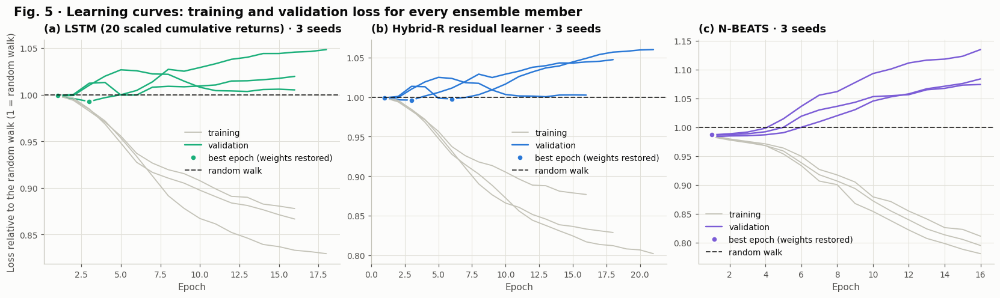

*Figure 5. Learning curves relative to the random walk.*

**How to read Figure 5.** Every loss is divided by the loss of the random walk on the same windows, so the **dashed line at 1 is the random walk**: below it the network is better, above it worse.

* **Grey (training) curves** fall steadily below 1 for all three models: the networks can always fit the training years.
* **Coloured (validation) curves** start at 1 (the random-walk start) and stay close to it, rising after the first few epochs as the networks begin to memorise noise. N-BEATS (c) starts slightly below 1 (about 0.99), consistent with its small validation edge in Table 12.
* **The dots** mark the epoch whose weights were restored by early stopping, always one of the first few epochs.

The gap between the falling training curves and the flat validation curves is the efficient-market hypothesis in one picture: patterns that exist in the training years do not carry over to new years.

### Hybrid-E: optimal per-horizon combination, with derivation

For each lead $h$ a convex weight $w_h$ combines SARIMA ($S$) and the LSTM ($L$):

$$\hat y^{\,\text{HE}} = w_h S + (1 - w_h) L .$$

The weight minimises the validation squared error $J(w) = \sum_t \big(y_t - w S_t - (1 - w)L_t\big)^2$. Write the error as $e_t(w) = (y_t - L_t) - w(S_t - L_t)$ and set the derivative to zero:

$$\frac{dJ}{dw} = -2\sum_t (S_t - L_t)\big[(y_t - L_t) - w(S_t - L_t)\big] = 0 \;\Longrightarrow\; w^* = \frac{\sum_t (L_t - y_t)(L_t - S_t)}{\sum_t (L_t - S_t)^2},$$

which is then clipped to $[0, 1]$ (Bates & Granger, 1969). Because both forecasts start from the same price, the weight is the same whether it is computed on log prices or on returns.

```python
def optimal_weights(S, L, Y):
    d = L - S
    return np.clip(np.sum((L - Y[:, None]) * d, axis=0) / np.maximum(np.sum(d * d, axis=0), 1e-18), 0.0, 1.0)
```

**Output.**

```text
Weight on SARIMA by lead: h=1: 0.00, h=2: 0.00, h=5: 0.00, h=10: 0.00, h=20: 0.24
Random walk  day-ahead return RMSE 0.8733 %
Drift        day-ahead return RMSE 0.8727 %
ARIMA        day-ahead return RMSE 0.8799 %
SARIMA       day-ahead return RMSE 0.8724 %
LSTM         day-ahead return RMSE 0.8726 %
N-BEATS      day-ahead return RMSE 0.8721 %
Hybrid-R     day-ahead return RMSE 0.8717 %
Hybrid-E     day-ahead return RMSE 0.8726 %
```

**Reading the output.** The validation years put **zero weight on SARIMA** for leads 1 to 10 and 0.24 at lead 20: on 2020 to 2021 the LSTM was the better short-range forecaster, so Hybrid-E is identical to the LSTM up to two weeks ahead. The day-ahead return RMSEs show the first sign of the final ranking: Hybrid-R has the smallest error (0.8717 %), ARIMA the largest (0.8799 %), and the random walk sits in the middle (0.8733 %).


## C.13 Evaluation on the untouched test period (notebook Section 13)

Everything in this section is computed on the 1,197 test days (3 January 2022 to 6 November 2026), which no model saw during training, tuning or calibration.

### 13.1 Price-level accuracy

**Table 13 · Day-ahead price accuracy over all 1,197 test days (NIFTY 50, index points)**

|  | Family | Price RMSE | Price MAE | Price MAPE (%) | Price R² |
|---|---|---|---|---|---|
| Random walk | Baseline | 185.33 | 135.41 | 0.638 | 0.99664 |
| Drift | Baseline | 185.26 | 135.25 | 0.637 | 0.99664 |
| ARIMA | Statistical | 186.90 | 136.08 | 0.640 | 0.99658 |
| SARIMA | Statistical | 185.15 | 135.19 | 0.637 | 0.99665 |
| LSTM | Deep learning | 185.20 | 135.34 | 0.638 | 0.99664 |
| N-BEATS | Deep learning | 185.09 | 135.19 | 0.637 | 0.99665 |
| Hybrid-R | Hybrid | 185.06 | 135.19 | 0.637 | 0.99665 |
| Hybrid-E | Hybrid | 185.20 | 135.34 | 0.638 | 0.99664 |

**Reading Table 13.** Every model, including the random walk, has a price R² of 0.9966 and a MAPE of about 0.64 %. As derived in Section C.6, this is what persistence alone produces, so the table shows that the forecasts are well-behaved but **cannot show which model is better**. Hybrid-R has the lowest price RMSE (185.06 index points against 185.33 for the random walk), but a difference of 0.27 points on an index near 25,000 is invisible in a price chart. This is why the following tables work with returns.

### 13.2 Return-level accuracy and direction

**Confidence intervals by block bootstrap.** Forecast errors on neighbouring days are not independent (volatility clusters), so ordinary bootstrap resampling of single days would understate the uncertainty. The **moving-block bootstrap** (Künsch, 1989) resamples blocks of 10 consecutive days with replacement until a series of the original length is built, recomputes the RMSE, and repeats this 1,000 times. The 2.5 % and 97.5 % quantiles of the 1,000 RMSE values form the 95 % confidence interval.

```python
def block_bootstrap_indices(n, n_boot=N_BOOT, block=BOOT_BLOCK, seed=SEED):
    rng = np.random.default_rng(seed)
    starts = rng.integers(0, n - block + 1, size=(n_boot, int(np.ceil(n / block))))
    return (starts[:, :, None] + np.arange(block)[None, None, :]).reshape(n_boot, -1)[:, :n]
```

**Table 14 · Day-ahead return accuracy and direction over all 1,197 test days**

|  | Family | Return RMSE (%) | Return RMSE 95 % CI (%) | Return MAE (%) | R²_OS vs random walk (%) | Directional accuracy (%) | Pesaran-Timmermann p |
|---|---|---|---|---|---|---|---|
| Random walk | Baseline | 0.8733 | 0.7831 to 0.9568 | 0.6379 | +0.00 | n/a | n/a |
| Drift | Baseline | 0.8727 | 0.7823 to 0.9578 | 0.6370 | +0.12 | 52.46 | n/a |
| ARIMA | Statistical | 0.8799 | 0.7847 to 0.9679 | 0.6403 | -1.51 | 51.55 | 0.2826 |
| SARIMA | Statistical | 0.8724 | 0.7815 to 0.9576 | 0.6368 | +0.20 | 52.55 | 0.3212 |
| LSTM | Deep learning | 0.8726 | 0.7828 to 0.9568 | 0.6376 | +0.16 | 52.46 | n/a |
| N-BEATS | Deep learning | 0.8721 | 0.7815 to 0.9561 | 0.6368 | +0.28 | 52.46 | n/a |
| Hybrid-R | Hybrid | 0.8717 | 0.7816 to 0.9553 | 0.6367 | +0.35 | 53.22 | 0.0008 |
| Hybrid-E | Hybrid | 0.8726 | 0.7828 to 0.9568 | 0.6376 | +0.16 | 52.46 | n/a |

**Reading Table 14, the decisive table.**

* **Hybrid-R is the best day-ahead model**: lowest return RMSE (0.8717 %), lowest MAE (0.6367 %), highest R²_OS (+0.35 %) and highest directional accuracy (53.22 %).
* **Five of the six learned models beat the random walk** (positive R²_OS), and so does Drift. Only ARIMA, selected by AIC, loses clearly (-1.51 %).
* **Directional accuracy needs care.** LSTM, N-BEATS and Hybrid-E all show 52.46 %, exactly the same as Drift, and their Pesaran-Timmermann p-value is n/a. The reason: on every one of the 1,197 test days these three models forecast a *positive* return, just like Drift, so their hit rate is simply the share of up days (52.46 %). The back-test confirms it (Table 20: 100 % invested, 1 trade).
* **Hybrid-R is the only model with a significant directional edge** (p = 0.0008). It forecast a fall on only about 10 days (it was invested 99.2 % of the time, Table 20), and on those days the index mostly did fall. The edge is statistically significant but rests on few events, so it is best presented as a promising signal rather than a proven trading rule.
* **The confidence intervals overlap heavily** (all around 0.78 % to 0.96 %), because all models face the same unpredictable market moves. Whether the small differences are real is a question for the *paired* tests in Sections 13.3 and 13.4.

### Figure 6 · Day-ahead price forecasts

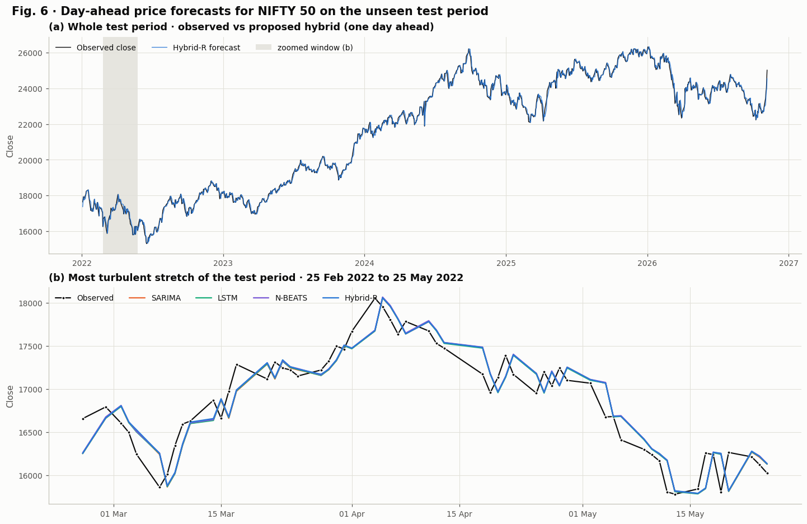

*Figure 6. Test-period forecasts.*

**How to read Figure 6.**

* **(a)** Over the whole test period the blue Hybrid-R forecast lies on top of the black observed close. The NIFTY 50 rose from about 17,500 to above 26,000 in 2024 and 2025, fell in early 2026 and recovered to about 25,000.
* **(b)** The most turbulent stretch (25 February to 25 May 2022, the start of the Russia-Ukraine war and global rate rises) shows what really happens: every forecast curve is the observed curve **shifted one day to the right**, and all four models are almost indistinguishable.

This is not a plotting error; it is what an efficient market looks like. The best forecast of tomorrow's price is close to today's price, so all models largely inherit today's close. Visual closeness is not evidence of skill, which is why the return-level tests decide.

### Figure 7 · The four headline metrics side by side

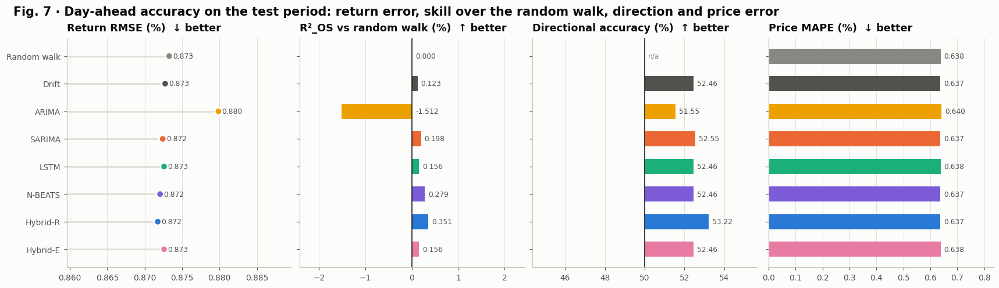

*Figure 7. Metric comparison across models.*

**How to read Figure 7.** Each panel ranks the eight models on one metric; the arrow says which direction is better.

* **Return RMSE** (dots): all models lie between 0.872 % and 0.880 %; Hybrid-R is furthest left (best), ARIMA furthest right (worst).
* **R²_OS** (bars from zero): the only clearly negative bar is ARIMA (-1.51 %); Hybrid-R has the longest positive bar (+0.351 %).
* **Directional accuracy** (bars from 50 %): Hybrid-R reaches 53.22 %; the random walk has no direction (n/a).
* **Price MAPE**: identical for everyone (0.637 % to 0.640 %), the persistence effect again.

### 13.3 Is the difference real? Diebold-Mariano tests

The **Diebold-Mariano test** (1995) compares two forecasts on the same days through the loss differential $d_t = e_{1,t}^2 - e_{2,t}^2$:

$$\text{DM} = \frac{\bar d}{\sqrt{\hat V(\bar d)}}, \qquad \hat V(\bar d) = \frac{1}{T}\Big(\hat\gamma_0 + 2\sum_{k=1}^{h-1}\hat\gamma_k\Big),$$

where $\hat\gamma_k$ are the autocovariances of $d_t$ (multi-step errors overlap, so up to $h-1$ lags are included). The Harvey-Leybourne-Newbold (1997) correction multiplies DM by $\sqrt{(T + 1 - 2h + h(h-1)/T)/T}$ and uses a Student-$t$ distribution, which is more reliable in finite samples. A **negative** DM means the first model (Hybrid-R) has the smaller errors.

```python
def diebold_mariano(e1, e2, h=1):
    d = e1 ** 2 - e2 ** 2
    T, d_bar = len(d), d.mean()
    autocov = [np.sum((d[k:] - d_bar) * (d[:T - k] - d_bar)) / T for k in range(h)]
    variance = max((autocov[0] + 2 * sum(autocov[1:])) / T, 1e-30)
    statistic = d_bar / np.sqrt(variance) * np.sqrt((T + 1 - 2 * h + h * (h - 1) / T) / T)
    return statistic, 2 * stats.t.sf(abs(statistic), df=T - 1)
```

**Table 15 · Diebold-Mariano tests of Hybrid-R against every other model (squared return errors, 5 % level)**

|  | DM (h=1) | p (h=1) | DM (h=5) | p (h=5) | Day-ahead verdict |
|---|---|---|---|---|---|
| Random walk | -0.80 | 0.4216 | -0.62 | 0.5339 | no significant difference |
| Drift | -0.82 | 0.4119 | -0.78 | 0.4361 | no significant difference |
| ARIMA | -1.96 | 0.0497 | -1.45 | 0.1461 | Hybrid-R significantly better |
| SARIMA | -0.66 | 0.5084 | -1.06 | 0.2893 | no significant difference |
| LSTM | -0.55 | 0.5796 | +0.07 | 0.9455 | no significant difference |
| N-BEATS | -0.38 | 0.7034 | +0.39 | 0.6981 | no significant difference |
| Hybrid-E | -0.55 | 0.5796 | +0.07 | 0.9455 | no significant difference |

**Reading Table 15.** Hybrid-R has a negative DM statistic against all seven competitors (it is more accurate on average), but only the comparison with ARIMA is significant at 5 % (p = 0.0497). Against the random walk (p = 0.42) and SARIMA (p = 0.51) the differences are within what chance could produce.

### 13.4 How much better? Improvement over every competitor

The headline numbers of the study. For a proposed model $P$ and a competitor $C$:

$$\text{Improvement}(\%) = 100\left(1 - \frac{\text{RMSE}_P}{\text{RMSE}_C}\right).$$

**+1 % means the proposed model's error is 1 % smaller.** The 95 % interval comes from the block bootstrap applied to *both* models on the same resampled days (a **paired** bootstrap), which respects the strong correlation between their errors.

**Holm correction for multiple comparisons.** Testing one model against seven competitors at the 5 % level gives a much higher chance than 5 % of at least one false "significant" result. The Holm (1979) step-down procedure fixes this: sort the $m = 7$ p-values $p_{(1)} \le \dots \le p_{(m)}$ and compute

$$\tilde p_{(i)} = \max_{j \le i}\ \min\big(1,\ (m - j + 1)\,p_{(j)}\big).$$

A comparison is declared significant only if $\tilde p < 0.05$. This keeps the probability of *any* false claim of superiority below 5 %.

```python
def holm_adjust(pvalues):
    names = list(pvalues)
    p = np.array([pvalues[k] for k in names], dtype=float)
    adjusted, running = np.empty(len(p)), 0.0
    for rank, i in enumerate(np.argsort(p)):
        running = max(running, min(1.0, (len(p) - rank) * p[i]))
        adjusted[i] = running
    return dict(zip(names, adjusted))
```

```python
def improvement_table(c, proposed, idx):
    actual, pred_p = model_returns(c, proposed, 1)
    e_p = actual - pred_p
    lead_rmse = {name: np.mean([np.sqrt(np.mean(np.subtract(*model_returns(c, name, h)) ** 2)) for h in LEADS]) for name in MODEL_ORDER}
    direction_p = return_metrics(actual, pred_p)["Directional accuracy (%)"]
    rows, pvalues = {}, {}
    for other in [m for m in MODEL_ORDER if m != proposed]:
        pred_o = model_returns(c, other, 1)[1]
        e_o = actual - pred_o
        boot = 100 * (1 - np.sqrt(np.mean(e_p[idx] ** 2, axis=1)) / np.sqrt(np.mean(e_o[idx] ** 2, axis=1)))
        low, high = np.percentile(boot, [2.5, 97.5])
        pvalues[other] = diebold_mariano(e_p, e_o, 1)[1]
        rows[other] = {"Return RMSE reduction h = 1 (%)": 100 * (1 - np.sqrt(np.mean(e_p ** 2)) / np.sqrt(np.mean(e_o ** 2))),
                       "95 % CI low": low, "95 % CI high": high,
                       "Return MAE reduction h = 1 (%)": 100 * (1 - np.mean(np.abs(e_p)) / np.mean(np.abs(e_o))),
                       "Direction gain h = 1 (points)": direction_p - return_metrics(actual, pred_o)["Directional accuracy (%)"],
                       f"Return RMSE reduction, mean of leads 1 to {H} (%)": 100 * (1 - lead_rmse[proposed] / lead_rmse[other]),
                       "DM p (h = 1)": pvalues[other]}
    table = pd.DataFrame(rows).T
    holm = holm_adjust(pvalues)
    table["Holm-adjusted p"] = [holm[m] for m in table.index]
    table["Verdict (5 %, Holm)"] = ["significantly better" if p < 0.05 and g > 0 else "significantly worse" if p < 0.05
                                    else "no significant difference"
                                    for p, g in zip(table["Holm-adjusted p"], table["Return RMSE reduction h = 1 (%)"])]
    return table
```

**Output.**

**Table 16 · How much better is the proposed Hybrid-R? Day-ahead return error reduction against every other model (positive = Hybrid-R better; 95 % paired block-bootstrap interval; Holm-corrected Diebold-Mariano test)**

|  | Return RMSE reduction h = 1 (%) | 95 % CI low | 95 % CI high | Return MAE reduction h = 1 (%) | Direction gain h = 1 (points) | Return RMSE reduction, mean of leads 1 to 20 (%) | DM p (h = 1) | Holm-adjusted p | Verdict (5 %, Holm) |
|---|---|---|---|---|---|---|---|---|---|
| Random walk | +0.176 | -0.248 | +0.580 | +0.195 | n/a | +0.673 | 0.4216 | 1.0000 | no significant difference |
| Drift | +0.114 | -0.145 | +0.370 | +0.052 | +0.75 | +0.128 | 0.4119 | 1.0000 | no significant difference |
| ARIMA | +0.922 | +0.110 | +1.722 | +0.565 | +1.67 | +0.126 | 0.0497 | 0.3480 | no significant difference |
| SARIMA | +0.077 | -0.151 | +0.272 | +0.016 | +0.67 | +0.097 | 0.5084 | 1.0000 | no significant difference |
| LSTM | +0.098 | -0.241 | +0.414 | +0.141 | +0.75 | -0.066 | 0.5796 | 1.0000 | no significant difference |
| N-BEATS | +0.036 | -0.123 | +0.226 | +0.030 | +0.75 | -0.252 | 0.7034 | 1.0000 | no significant difference |
| Hybrid-E | +0.098 | -0.241 | +0.414 | +0.141 | +0.75 | -0.089 | 0.5796 | 1.0000 | no significant difference |

**Table 17 · How much better is Hybrid-E? Day-ahead return error reduction against every other model (positive = Hybrid-E better; 95 % paired block-bootstrap interval; Holm-corrected Diebold-Mariano test)**

|  | Return RMSE reduction h = 1 (%) | 95 % CI low | 95 % CI high | Return MAE reduction h = 1 (%) | Direction gain h = 1 (points) | Return RMSE reduction, mean of leads 1 to 20 (%) | DM p (h = 1) | Holm-adjusted p | Verdict (5 %, Holm) |
|---|---|---|---|---|---|---|---|---|---|
| Random walk | +0.078 | -0.026 | +0.169 | +0.054 | n/a | +0.761 | 0.1312 | 0.7872 | no significant difference |
| Drift | +0.017 | -0.116 | +0.168 | -0.090 | +0.00 | +0.217 | 0.8129 | 1.0000 | no significant difference |
| ARIMA | +0.825 | +0.100 | +1.582 | +0.424 | +0.92 | +0.215 | 0.0670 | 0.4689 | no significant difference |
| SARIMA | -0.021 | -0.208 | +0.132 | -0.126 | -0.08 | +0.186 | 0.8256 | 1.0000 | no significant difference |
| LSTM | +0.000 | +0.000 | +0.000 | +0.000 | +0.00 | +0.023 | 1.0000 | 1.0000 | no significant difference |
| N-BEATS | -0.062 | -0.309 | +0.196 | -0.111 | +0.00 | -0.163 | 0.6387 | 1.0000 | no significant difference |
| Hybrid-R | -0.098 | -0.416 | +0.241 | -0.142 | -0.75 | +0.089 | 0.5796 | 1.0000 | no significant difference |

### Figure 8 · The improvement forest plot

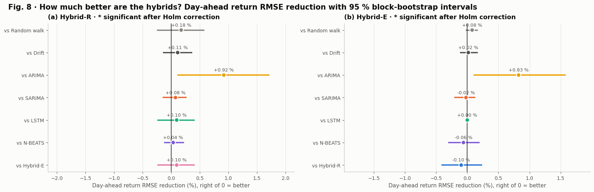

*Figure 8. Improvement over each competitor with 95 % intervals.*

**How to read Figure 8.** Each row is one comparison. The dot is the RMSE reduction and the horizontal bar its 95 % bootstrap interval; right of the vertical line means the proposed model is better. A star would mark a comparison that stays significant after the Holm correction.

* **(a) Hybrid-R** is to the right of zero against **every** competitor (between +0.04 % and +0.92 %). Against ARIMA the whole interval (+0.11 % to +1.72 %) is right of zero, but after the Holm correction the p-value is 0.35, so no star is shown.
* **(b) Hybrid-E** sits exactly at 0.00 % against the LSTM (it *is* the LSTM up to two weeks ahead, Section C.12) and slightly to the left of zero against Hybrid-R.

**The honest conclusion for a paper:** Hybrid-R improves on every competitor, by 0.04 % to 0.92 % in RMSE, but none of these improvements survives the multiple-comparison correction. For daily stock returns this is the expected outcome.

### 13.5 How does skill change with the horizon?

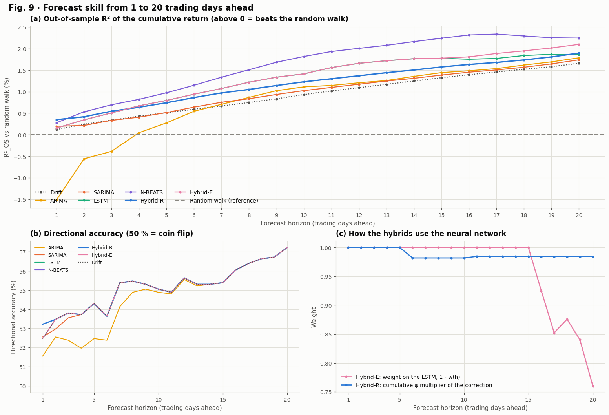

*Figure 9. Accuracy by forecast horizon.*

**Table 18 · Out-of-sample R² vs the random walk (%) by horizon**

|  | h = 1 | h = 2 | h = 5 | h = 10 | h = 20 | Mean 1 to 20 |
|---|---|---|---|---|---|---|
| Random walk | +0.00 | +0.00 | +0.00 | +0.00 | +0.00 | +0.00 |
| Drift | +0.12 | +0.24 | +0.51 | +0.93 | +1.66 | +0.95 |
| ARIMA | -1.51 | -0.56 | +0.28 | +1.11 | +1.79 | +0.83 |
| SARIMA | +0.20 | +0.22 | +0.52 | +1.03 | +1.74 | +1.00 |
| LSTM | +0.16 | +0.35 | +0.80 | +1.41 | +1.87 | +1.30 |
| N-BEATS | +0.28 | +0.53 | +0.98 | +1.82 | +2.25 | +1.63 |
| Hybrid-R | +0.35 | +0.42 | +0.74 | +1.23 | +1.90 | +1.20 |
| Hybrid-E | +0.16 | +0.35 | +0.80 | +1.41 | +2.10 | +1.34 |

**Table 19 · Directional accuracy (%) by horizon**

|  | h = 1 | h = 2 | h = 5 | h = 10 | h = 20 | Mean 1 to 20 |
|---|---|---|---|---|---|---|
| Random walk | n/a | n/a | n/a | n/a | n/a | n/a |
| Drift | 52.46 | 53.47 | 54.30 | 55.05 | 57.23 | 55.11 |
| ARIMA | 51.55 | 52.55 | 52.46 | 54.89 | 57.23 | 54.58 |
| SARIMA | 52.55 | 52.97 | 54.30 | 55.05 | 57.23 | 55.08 |
| LSTM | 52.46 | 53.47 | 54.30 | 55.05 | 57.23 | 55.11 |
| N-BEATS | 52.46 | 53.47 | 54.30 | 55.05 | 57.23 | 55.11 |
| Hybrid-R | 53.22 | 53.47 | 54.30 | 55.05 | 57.23 | 55.15 |
| Hybrid-E | 52.46 | 53.47 | 54.30 | 55.05 | 57.23 | 55.11 |

**How to read Figure 9 and Tables 18 and 19.**

* **(a) R²_OS rises with the horizon for almost every model**, from about 0.1 % to 0.4 % at one day to between 1.7 % and 2.3 % at 20 days. The reason is the **drift**: the NIFTY 50 rose about 8 % a year during the test period, and any model that forecasts a small positive mean return gains more relative to the random walk (which forecasts zero) as the horizon grows. The dotted Drift line shows this effect alone.
* **N-BEATS is best at long horizons** (mean R²_OS +1.63 % over leads 1 to 20, +2.25 % at 20 days), while **Hybrid-R is best one day ahead**. ARIMA starts far below zero and only crosses zero after about four trading days, when its short-memory dynamics have died out.
* **(b) Directional accuracy also rises with the horizon**, to 57.23 % at 20 days for almost all models. That number is simply the share of 20-day windows in which the index rose: at long horizons every model forecasts "up" and is right whenever the market rose.
* **(c) How the hybrids use the network.** Hybrid-E puts all weight on the LSTM (pink line at 1.0) up to 15 days, then shifts towards SARIMA. Hybrid-R's correction multiplier $\sum_{k<h}\psi_k$ (blue) stays near 1.0: SARIMA's weekly terms are tiny, so tomorrow's correction is carried almost unchanged into the cumulative return.

### 13.6 Economic value: a trading back-test

**The rule.** At every close, hold the NIFTY 50 for the next day if the model's forecast return is positive, otherwise hold cash. Every change of position costs $c = 0.05\,\%$:

$$\pi_t = \mathbf 1\{\hat r_{t+1} > 0\}, \qquad g_{t+1} = \pi_t\,(e^{r_{t+1}} - 1) - c\,\lvert \pi_t - \pi_{t-1}\rvert .$$

**The performance measures.** With $V_T = \prod_t (1 + g_t)$ the final value of one unit and $Y$ the number of years:

$$\text{CAGR} = V_T^{1/Y} - 1, \qquad \text{Sharpe} = \frac{\bar g}{s_g}\sqrt{252}, \qquad \text{MDD} = \min_t\left(\frac{V_t}{\max_{u \le t} V_u} - 1\right).$$

The Sharpe ratio uses a zero risk-free rate for simplicity. The benchmark is buy and hold.

```python
def strategy_returns(c, name):
    actual, predicted = model_returns(c, name, 1)
    position = (predicted > 0).astype(float)
    turnover = np.abs(np.diff(np.r_[0.0, position]))
    return position * np.expm1(actual) - COST * turnover, position
```

```python
def performance(daily, position=None):
    equity = np.cumprod(1 + daily)
    years = len(daily) / TRADING_DAYS
    sd = daily.std()
    out = {"CAGR (%)": 100 * (equity[-1] ** (1 / years) - 1), "Volatility (%)": 100 * sd * np.sqrt(TRADING_DAYS),
           "Sharpe ratio": daily.mean() / sd * np.sqrt(TRADING_DAYS) if sd > 0 else np.nan,
           "Max drawdown (%)": 100 * (equity / np.maximum.accumulate(equity) - 1).min(), "Final value of 1 unit": equity[-1]}
    out["Days invested (%)"] = 100 * (position.mean() if position is not None else 1.0)
    out["Trades"] = int(np.abs(np.diff(np.r_[0.0, position])).sum()) if position is not None else 1
    return out
```

**Table 20 · Long-or-cash trading back-test on the test period, after 0.05 % costs per trade**

|  | CAGR (%) | Volatility (%) | Sharpe ratio | Max drawdown (%) | Final value of 1 unit | Days invested (%) | Trades |
|---|---|---|---|---|---|---|---|
| Buy and hold | +8.00 | 13.84 | 0.626 | -16.47 | 1.442 | 100.0 | 1 |
| ARIMA | -1.69 | 10.82 | -0.103 | -26.11 | 0.922 | 65.3 | 601 |
| SARIMA | +7.26 | 13.67 | 0.581 | -17.64 | 1.395 | 97.2 | 65 |
| LSTM | +8.00 | 13.84 | 0.626 | -16.47 | 1.442 | 100.0 | 1 |
| N-BEATS | +8.00 | 13.84 | 0.626 | -16.47 | 1.442 | 100.0 | 1 |
| Hybrid-R | +8.67 | 13.82 | 0.671 | -15.77 | 1.485 | 99.2 | 19 |
| Hybrid-E | +8.00 | 13.84 | 0.626 | -16.47 | 1.442 | 100.0 | 1 |

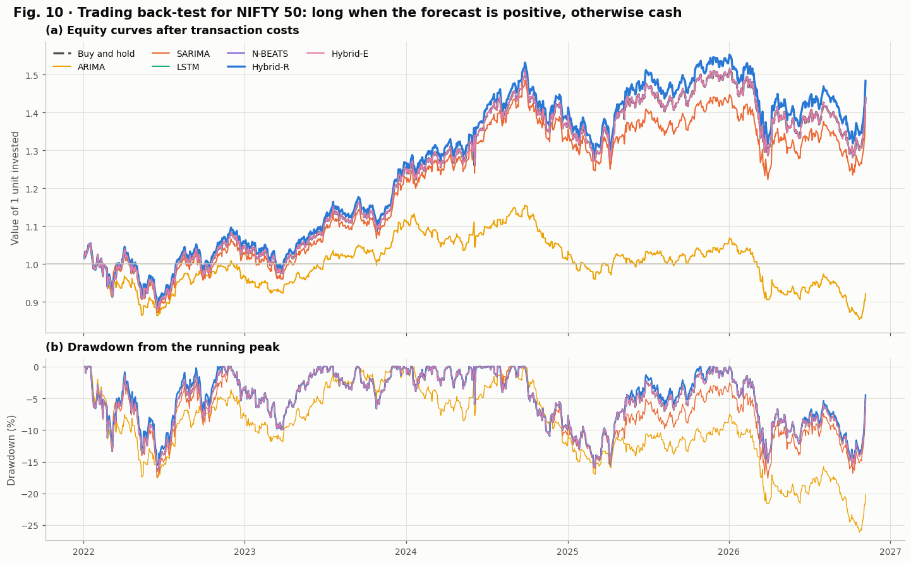

*Figure 10. Long-or-cash back-test.*

**How to read Table 20 and Figure 10.**

* **Hybrid-R beats buy and hold** on every measure: CAGR 8.67 % against 8.00 %, Sharpe ratio 0.671 against 0.626 (**+7.2 %**), maximum drawdown -15.77 % against -16.47 %, and a final value of 1.485 against 1.442. It traded only 19 times in almost five years, so costs are negligible.
* **LSTM, N-BEATS and Hybrid-E are identical to buy and hold** (100 % invested, 1 trade): they forecast "up" every day.
* **ARIMA is a warning example.** It switched in and out 601 times, paid costs every time, and lost money (CAGR -1.69 %, final value 0.922). An over-fitted model is worse than doing nothing.
* In Figure 10(a) the thick blue Hybrid-R curve stays above the overlapping buy-and-hold family from 2024 onwards; Figure 10(b) shows its drawdowns are slightly shallower in the 2024 and 2026 sell-offs.

### 13.7 Robustness across years and volatility regimes

**Table 21 · Day-ahead R²_OS vs the random walk (%) by test year (2026 runs to early November)**

|  | 2022 | 2023 | 2024 | 2025 | 2026 |
|---|---|---|---|---|---|
| Random walk | +0.00 | +0.00 | +0.00 | +0.00 | +0.00 |
| Drift | +0.01 | +0.93 | +0.15 | +0.27 | -0.24 |
| ARIMA | -0.74 | +2.14 | -4.13 | -0.56 | -2.54 |
| SARIMA | -0.27 | +1.26 | +0.66 | +0.42 | -0.23 |
| LSTM | +0.18 | +0.21 | +0.08 | +0.13 | +0.20 |
| N-BEATS | -0.02 | +0.86 | +0.67 | +0.50 | -0.11 |
| Hybrid-R | +0.05 | +1.24 | +0.78 | +0.45 | -0.13 |
| Hybrid-E | +0.18 | +0.21 | +0.08 | +0.13 | +0.20 |

**Table 22 · Day-ahead skill by volatility regime (training terciles 15.9 and 20.9; test days: low 823, medium 273, high 101)**

|  | Low VIX: R²_OS (%) | Low VIX: direction (%) | Medium VIX: R²_OS (%) | Medium VIX: direction (%) | High VIX: R²_OS (%) | High VIX: direction (%) |
|---|---|---|---|---|---|---|
| Random walk | +0.00 | n/a | +0.00 | n/a | +0.00 | n/a |
| Drift | +0.04 | 52.98 | -0.08 | 51.65 | +0.45 | 50.50 |
| ARIMA | +0.14 | 52.25 | -0.71 | 50.92 | -4.71 | 47.52 |
| SARIMA | +0.15 | 52.61 | -0.16 | 53.48 | +0.60 | 49.50 |
| LSTM | +0.08 | 52.98 | +0.09 | 51.65 | +0.33 | 50.50 |
| N-BEATS | +0.16 | 52.98 | -0.26 | 51.65 | +0.96 | 50.50 |
| Hybrid-R | -0.11 | 53.34 | -0.02 | 53.48 | +1.38 | 51.49 |
| Hybrid-E | +0.08 | 52.98 | +0.09 | 51.65 | +0.33 | 50.50 |

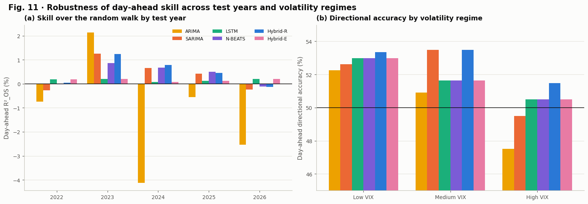

*Figure 11. Accuracy by year and volatility regime.*

**How to read Tables 21 and 22 and Figure 11.**

* **By year (a):** Hybrid-R beats the random walk in 2023 (+1.24 %), 2024 (+0.78 %) and 2025 (+0.45 %), is neutral in 2022 (+0.05 %) and slightly negative in 2026 (-0.13 %). ARIMA swings wildly (+2.14 % in 2023, -4.13 % in 2024), the typical behaviour of an over-fitted model.
* **By volatility regime (b):** the regimes are defined by the India VIX terciles of the *training* years (15.9 and 20.9), so no test information is used. Hybrid-R has the highest or tied-highest directional accuracy in every regime (53.3 %, 53.5 % and 51.5 %), and its largest R²_OS gain is in the **high-VIX regime** (+1.38 %), exactly when forecasts matter most. ARIMA falls below a coin flip (47.5 %) in turbulent markets.

### 13.8 Residual diagnostics

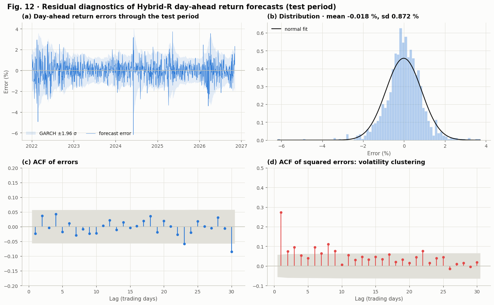

*Figure 12. Residual diagnostics.*

**Table 23 · Day-ahead error diagnostics (test period; bp = basis points, 1 bp = 0.01 %)**

|  | Bias (bp) | Error sd (%) | Skewness | Excess kurtosis | Ljung-Box p, errors | Ljung-Box p, squared errors |
|---|---|---|---|---|---|---|
| Random walk | +3.06 | 0.8727 | -0.40 | 4.02 | 0.5284 | 1.69e-29 |
| Drift | +0.03 | 0.8727 | -0.40 | 4.02 | 0.5284 | 8.28e-29 |
| ARIMA | +0.02 | 0.8799 | -0.37 | 4.44 | 0.0008 | 6.31e-33 |
| SARIMA | +0.06 | 0.8724 | -0.41 | 4.04 | 0.6524 | 8.46e-29 |
| LSTM | +2.23 | 0.8723 | -0.41 | 4.03 | 0.5361 | 4.00e-29 |
| N-BEATS | -1.00 | 0.8720 | -0.43 | 4.05 | 0.5329 | 1.02e-27 |
| Hybrid-R | -1.75 | 0.8716 | -0.43 | 4.07 | 0.6893 | 2.72e-27 |
| Hybrid-E | +2.23 | 0.8723 | -0.41 | 4.03 | 0.5361 | 4.00e-29 |

**How to read Figure 12 and Table 23.**

* **(a) Errors over time** stay mostly inside the shaded GARCH ±1.96σ band, which widens in turbulent periods. The largest miss (about -6 %) is a single day in June 2024, the general-election result day, when the index fell by about 6 %: no model using past prices can foresee such an event.
* **(b) Distribution:** mean -0.018 % (essentially unbiased), standard deviation 0.872 %, peaked with fat tails.
* **(c) ACF of errors:** inside the significance band; Ljung-Box p = 0.69 (Table 23). The errors contain **no remaining linear pattern**, so Hybrid-R has extracted the linear predictability that exists.
* **(d) ACF of squared errors:** clearly outside the band (lag 1 about 0.27); Ljung-Box p ≈ 10⁻²⁷. The errors still show **volatility clustering**, which is exactly why the prediction intervals in Section C.14 are scaled by GARCH.
* **Table 23** shows the same pattern for every model, and confirms ARIMA as the only model with autocorrelated errors (p = 0.0008), another symptom of over-fitting.

### 13.9 Ablation study: what does each part of Hybrid-R contribute?

An ablation removes one component at a time and measures the change. Four reduced versions of Hybrid-R are compared with the full model:

| Variant | What is removed |
|---|---|
| SARIMA alone | the whole neural correction |
| Correction to the day-1 return only | the ψ-weight propagation |
| Correction repeated on every day's return | the decay of the correction |
| Single-task residual network | the auxiliary targets (a new network predicts only SARIMA's error) |

```python
def single_task_correction(c):
    z = (np.nan_to_num(c.innovations) / np.sqrt(c.garch_s2)).astype("float32")

    def targets(origins):
        return z[origins + 1][:, None]

    members, _ = train_ensemble(c, c.X_res, targets, "residual_single_task", verbose=False)
    all_origins = np.append(c.origins, c.n - 1)
    correction = ensemble_predict(members, c.X_res, all_origins, c.lstm_cfg["lookback"])[:, 0] * np.sqrt(c.garch_v1[all_origins])
    del members
    gc.collect()
    return correction
```

```text
Single-task residual ensemble trained and evaluated in 38 s
```

**Table 24 · Ablation of Hybrid-R on the test period (R²_OS in %; negative change = the reduced model is worse, so the removed part helps)**

|  | R²_OS h = 1 (%) | R²_OS h = 5 (%) | R²_OS h = 20 (%) | Mean R²_OS 1 to 20 (%) | Change vs full, h = 1 (points) | Change vs full, mean (points) |
|---|---|---|---|---|---|---|
| SARIMA alone (no neural correction) | +0.198 | +0.517 | +1.740 | +1.000 | -0.154 | -0.195 |
| Correction to the day-1 return only (no ψ propagation) | +0.351 | +0.744 | +1.898 | +1.198 | +0.000 | +0.002 |
| Correction repeated on every day's return | +0.351 | +1.309 | +3.188 | +2.159 | +0.000 | +0.964 |
| Single-task residual network (no auxiliary targets) | +0.361 | +0.678 | +1.795 | +1.120 | +0.010 | -0.075 |
| Full Hybrid-R (proposed) | +0.351 | +0.744 | +1.896 | +1.195 | +0.000 | +0.000 |

**Reading Table 24.** A negative change means the reduced model is worse, so the removed part helps.

* **The neural correction helps:** SARIMA alone has an R²_OS of +0.198 % one day ahead; adding the LSTM correction raises it to +0.351 % (**+0.15 points**) and the mean over 20 leads from +1.00 % to +1.20 %.
* **ψ propagation is neutral here** (+0.002 points over 20 leads), because SARIMA's weekly terms are tiny, so ψ is close to (1, 0, 0, ...). It costs nothing and protects the hybrid when the linear model has stronger dynamics.
* **Auxiliary targets:** the single-task network is marginally better one day ahead (+0.010 points) and worse over 20 leads (-0.075 points): the auxiliary tasks mainly help at longer horizons.
* **A result to explain honestly:** repeating the correction on every day's return gives a much higher mean R²_OS (+2.16 % against +1.20 %). The correction is on average slightly positive, so repeating it adds an extra upward drift, which paid off in a rising test market. It is not a better model, it is a bet on the market rising, and a falling market would punish it. This is exactly the kind of result an ablation is meant to expose.

### 13.10 Computational cost

**Table 25 · Model size, run time and accuracy for NIFTY 50 (times include the hyperparameter search; the hybrids include their SARIMA, GARCH and LSTM components)**

|  | Parameters | Wall-clock time (s) | Day-ahead R²_OS (%) | Mean R²_OS 1 to 20 (%) |
|---|---|---|---|---|
| Random walk | 0 | 0 | +0.00 | +0.00 |
| Drift | 1 | 0 | +0.12 | +0.95 |
| ARIMA | 5 | 15 | -1.51 | +0.83 |
| SARIMA | 4 | 34 | +0.20 | +1.00 |
| LSTM | 377,628 | 141 | +0.16 | +1.30 |
| N-BEATS | 701,316 | 162 | +0.28 | +1.63 |
| Hybrid-R | 379,171 | 66 | +0.35 | +1.20 |
| Hybrid-E | 377,652 | 175 | +0.16 | +1.34 |
| GARCH(1,1) | 3 | 0 | n/a | n/a |

**Reading Table 25.** The statistical models have 3 to 5 parameters and fit in seconds; the neural ensembles have 377,628 (LSTM, verified in Section C.10) to 701,316 (N-BEATS, three members of 233,772) parameters and take 2 to 3 minutes including the hyperparameter search. Hybrid-R needs 379,171 parameters (SARIMA 4, GARCH 3, residual network 379,164) and 66 seconds, and delivers the best day-ahead accuracy: **About 75,000 times more parameters than ARIMA buy a 1.9-point higher R²_OS one day ahead.**

## C.14 Uncertainty and risk (notebook Section 14)

### Split-conformal prediction intervals, scaled by GARCH

A forecast without an error bar is incomplete. Two interval types are compared.

**Gaussian GARCH** (for SARIMA): $\ln \hat P_{t+h} \pm z_{0.975}\,\hat s_{t,h}$ with $z_{0.975} = 1.96$. It assumes normal errors, which Figure 2 shows is unrealistic.

**GARCH-scaled split conformal** (for every learned model; Lei et al., 2018). On the validation days compute the *normalised* errors

$$s_j = \frac{\lvert y_j - \hat y_j \rvert}{\hat s_{j,h}} ,$$

take the $\lceil (n + 1)(1 - \alpha) \rceil$-th smallest of the $n$ scores as $q_h$, and use the interval $\hat y \pm q_h\,\hat s_{t,h}$. If the validation and test scores are exchangeable, this interval contains the truth with probability at least $1 - \alpha$, **without any assumption about the shape of the distribution**: fat tails are learned from the data. The GARCH factor makes the width time-varying.

```python
def compute_intervals(c):
    scale_val, scale_test = scale_at(c, c.val_targets), scale_at(c, c.test_targets)
    level = min(1.0, np.ceil((len(c.val_targets) + 1) * (1 - ALPHA)) / len(c.val_targets))
    c.half = {}
    for name in LEARNED:
        scores = np.abs(c.p[c.val_targets][:, None] - c.FC[name]["val"]) / scale_val
        q = np.quantile(scores, level, axis=0, method="higher")
        c.half[name] = {"model": name, "method": "GARCH-scaled conformal", "test": q[None, :] * scale_test,
                        "future": q * c.garch_cumsd[c.n - 1]}
    c.half["SARIMA (Gaussian GARCH)"] = {"model": "SARIMA", "method": "Gaussian GARCH", "test": Z * scale_test,
                                        "future": Z * c.garch_cumsd[c.n - 1]}
```

**Table 26 · Calibration of 95 % prediction intervals on the test period (width in % of price)**

|  | Method | Coverage h = 1 | Coverage h = 5 | Coverage h = 20 | Coverage, all 20 leads | Mean width h = 1 (%) | Mean width h = 20 (%) |
|---|---|---|---|---|---|---|---|
| ARIMA | GARCH-scaled conformal | 96.4 | 96.5 | 97.7 | 97.9 | 3.66 | 18.47 |
| SARIMA | GARCH-scaled conformal | 96.6 | 96.7 | 97.7 | 97.9 | 3.73 | 18.31 |
| LSTM | GARCH-scaled conformal | 97.2 | 97.2 | 98.3 | 98.2 | 3.80 | 19.26 |
| N-BEATS | GARCH-scaled conformal | 96.7 | 96.7 | 97.7 | 97.9 | 3.72 | 18.49 |
| Hybrid-R | GARCH-scaled conformal | 96.7 | 96.6 | 97.7 | 98.0 | 3.72 | 18.31 |
| Hybrid-E | GARCH-scaled conformal | 97.2 | 97.2 | 98.3 | 98.1 | 3.80 | 19.03 |
| SARIMA (Gaussian GARCH) | Gaussian GARCH | 95.6 | 94.4 | 95.5 | 95.6 | 3.43 | 15.99 |

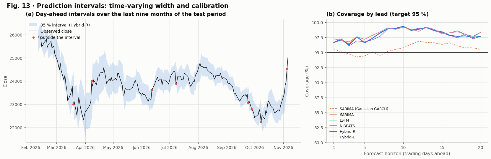

*Figure 13. Prediction intervals and coverage.*

**How to read Table 26 and Figure 13.**

* **Gaussian GARCH intervals are well calibrated**: 95.6 % coverage one day ahead and over all 20 leads, against the 95 % target.
* **The conformal intervals are conservative** (96.4 % to 98.3 %), about 3.7 % wide one day ahead. They were calibrated on 2020 to 2021, whose COVID-19 crash had heavier tails than the calmer test years, so they are slightly too wide. Too wide is the safe failure mode for risk management.
* **Figure 13(a)** shows Hybrid-R's 95 % band over the last nine months of the test period. The band widens when GARCH volatility rises (March to April 2026) and narrows in calm months; only a handful of days (red dots) fall outside.
* **Figure 13(b)** shows coverage by lead: the conformal curves sit above 95 % at every lead, the Gaussian GARCH curve stays close to 95 %.

### A first comparison of volatility forecasts

**Table 27 · One-day-ahead volatility forecast evaluation on the test period (lower QLIKE is better)**

|  | QLIKE | RMSE of variance (%²) | Mincer-Zarnowitz R² (%) |
|---|---|---|---|
| GARCH(1,1) | -8.6173 | 1.8350 | 4.70 |
| EWMA (λ = 0.94) | -8.6022 | 1.8388 | 4.27 |
| 21-day rolling variance | -8.5632 | 1.8694 | 3.23 |

**Reading Table 27.** GARCH(1,1) has the best (lowest) QLIKE loss against EWMA and a 21-day rolling variance, and explains the most variation of next-day squared returns (Mincer-Zarnowitz R² 4.7 %). The R² looks small because a single squared return is a very noisy measure of volatility; Part E replaces it with a far more precise measure.

## C.15 Multi-asset generalisation (notebook Section 15)

One asset is one sample. The identical pipeline (same split, same selection rules, the same random searches run on each asset's own validation years) is applied to four more assets. To fit in the memory of a free Colab runtime, each asset's networks are released after its results are stored (Part D).

```python
def run_pipeline(name):
    c = make_context(name)
    fit_baselines(c)
    fit_arima(c)
    fit_sarima(c)
    fit_garch(c)
    prepare_features(c)
    c.lstm_tuning = tune_lstm(c, verbose=False)
    fit_lstm(c, verbose=False)
    prepare_nbeats(c)
    c.nbeats_tuning = tune_nbeats(c, verbose=False)
    fit_nbeats(c, verbose=False)
    fit_hybrid_r(c, verbose=False)
    fit_hybrid_e(c)
    compute_intervals(c)
    return c
```

```text
NIFTY Bank  done in  484 s · ARIMA(0, 1, 1) · SARIMA(0, 1, 0)(1, 0, 0, 5) · Hybrid-R day-ahead R²_OS +0.27 %, direction 53.34 %
Reliance    done in  369 s · ARIMA(2, 1, 2) · SARIMA(0, 1, 0)(1, 0, 0, 5) · Hybrid-R day-ahead R²_OS +0.03 %, direction 50.67 %
TCS         done in  447 s · ARIMA(2, 1, 2) · SARIMA(1, 1, 1)(1, 0, 1, 5) · Hybrid-R day-ahead R²_OS -1.62 %, direction 48.83 %
S&P 500     done in  471 s · ARIMA(3, 1, 0) · SARIMA(1, 1, 0)(0, 0, 1, 5) · Hybrid-R day-ahead R²_OS -2.01 %, direction 52.26 %
```

**Table 28 · Day-ahead R²_OS vs the random walk (%) by asset; last row: mean rank across assets (1 = best)**

|  | Drift | ARIMA | SARIMA | LSTM | N-BEATS | Hybrid-R | Hybrid-E |
|---|---|---|---|---|---|---|---|
| NIFTY 50 | +0.12 | -1.51 | +0.20 | +0.16 | +0.28 | +0.35 | +0.16 |
| NIFTY Bank | +0.16 | -1.86 | +0.28 | +0.17 | +0.23 | +0.27 | +0.17 |
| Reliance | +0.00 | -0.34 | +0.03 | +0.01 | +0.13 | +0.03 | +0.01 |
| TCS | -0.51 | -2.01 | -1.10 | -1.04 | -0.89 | -1.62 | -1.10 |
| S&P 500 | +0.11 | -1.36 | -0.75 | -1.10 | +0.07 | -2.01 | -0.75 |
| Mean rank | +4.00 | +6.80 | +3.00 | +4.30 | +2.00 | +3.60 | +4.30 |

**Table 29 · Day-ahead directional accuracy (%) by asset**

|  | Drift | ARIMA | SARIMA | LSTM | N-BEATS | Hybrid-R | Hybrid-E |
|---|---|---|---|---|---|---|---|
| NIFTY 50 | 52.46 | 51.55 | 52.55 | 52.46 | 52.46 | 53.22 | 52.46 |
| NIFTY Bank | 53.18 | 51.67 | 54.43 | 53.18 | 53.18 | 53.34 | 53.18 |
| Reliance | 50.58 | 51.50 | 50.67 | 50.58 | 49.50 | 50.67 | 50.58 |
| TCS | 47.58 | 48.08 | 48.75 | 47.58 | 47.58 | 48.83 | 48.75 |
| S&P 500 | 52.83 | 51.19 | 51.11 | 52.42 | 52.59 | 52.26 | 51.11 |

**Table 30 · Mean R²_OS (%) over all leads 1 to 20 by asset; last row: mean rank (1 = best)**

|  | Drift | ARIMA | SARIMA | LSTM | N-BEATS | Hybrid-R | Hybrid-E |
|---|---|---|---|---|---|---|---|
| NIFTY 50 | +0.95 | +0.83 | +1.00 | +1.30 | +1.63 | +1.20 | +1.34 |
| NIFTY Bank | +1.19 | +0.91 | +1.32 | +0.06 | +1.63 | +1.25 | +0.06 |
| Reliance | -0.19 | +0.05 | -0.12 | +0.06 | +0.20 | -0.12 | -0.12 |
| TCS | -5.19 | -5.78 | -6.08 | -7.55 | -6.24 | -6.40 | -6.05 |
| S&P 500 | +1.53 | +1.53 | +1.77 | -7.63 | +2.46 | +1.66 | -6.52 |
| Mean rank | +4.60 | +4.20 | +3.60 | +5.10 | +1.80 | +4.40 | +4.30 |

**Table 31 · Sharpe ratio of the long-or-cash back-test by asset (after costs)**

|  | Buy and hold | ARIMA | SARIMA | LSTM | N-BEATS | Hybrid-R | Hybrid-E |
|---|---|---|---|---|---|---|---|
| NIFTY 50 | 0.626 | -0.103 | 0.581 | 0.626 | 0.626 | 0.671 | 0.626 |
| NIFTY Bank | 0.723 | 0.260 | 0.691 | 0.723 | 0.723 | 0.617 | 0.723 |
| Reliance | 0.305 | 0.713 | 0.307 | 0.305 | 0.049 | 0.307 | 0.305 |
| TCS | -0.121 | -0.426 | -0.073 | -0.121 | -0.121 | -0.006 | -0.073 |
| S&P 500 | 0.612 | 0.343 | 0.091 | 0.569 | 0.529 | 0.346 | 0.091 |

**Table 32 · Model orders, volatility persistence and hyperparameters selected for each asset**

|  | ARIMA order | SARIMA order | GARCH persistence | LSTM lookback | LSTM units | LSTM dropout | LSTM learning_rate | LSTM batch_size | LSTM validation MSE ratio | N-BEATS lookback | N-BEATS dropout | N-BEATS learning_rate | N-BEATS validation MSE ratio | Hybrid-R interval coverage, all 20 leads (%) |
|---|---|---|---|---|---|---|---|---|---|---|---|---|---|---|
| NIFTY 50 | (2, 1, 1) | (0, 1, 0)(1, 0, 1, 5) | 0.9940 | 20 | 128 / 64 | 0.3 | 0.0001 | 64 | 0.9937 | 120 | 0.1 | 0.0003 | 0.9870 | 98.0 |
| NIFTY Bank | (0, 1, 1) | (0, 1, 0)(1, 0, 0, 5) | 0.9944 | 60 | 128 / 64 | 0.5 | 0.0001 | 32 | 0.9850 | 20 | 0.1 | 0.0001 | 1.0024 | 98.0 |
| Reliance | (2, 1, 2) | (0, 1, 0)(1, 0, 0, 5) | 0.9811 | 60 | 32 / 16 | 0.3 | 0.0001 | 128 | 0.9995 | 120 | 0.1 | 0.0003 | 0.9914 | 98.7 |
| TCS | (2, 1, 2) | (1, 1, 1)(1, 0, 1, 5) | 0.9627 | 60 | 128 / 64 | 0.5 | 0.0001 | 32 | 0.9574 | 120 | 0.1 | 0.0003 | 0.9565 | 96.2 |
| S&P 500 | (3, 1, 0) | (1, 1, 0)(0, 0, 1, 5) | 0.9804 | 20 | 128 / 64 | 0.3 | 0.0001 | 64 | 0.9331 | 60 | 0.1 | 0.0001 | 0.9697 | 96.1 |

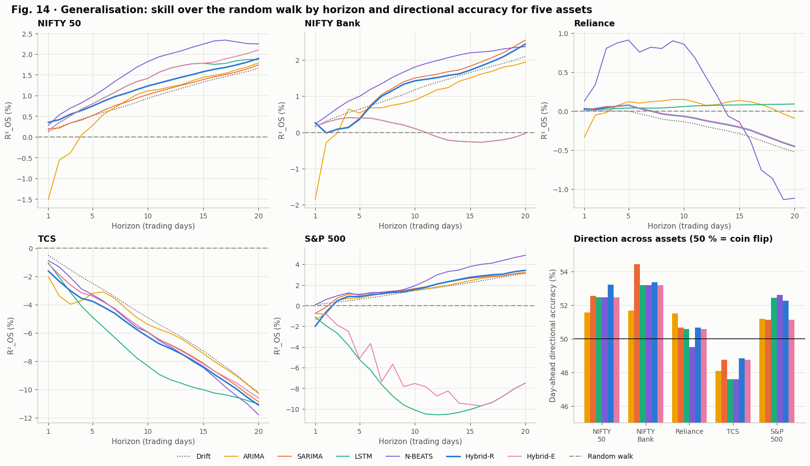

*Figure 14. Multi-asset comparison.*

**How to read the multi-asset results.**

* **Day-ahead (Table 28):** Hybrid-R beats the random walk on NIFTY 50 (+0.35 %), NIFTY Bank (+0.27 %) and Reliance (+0.03 %), but not on TCS (-1.62 %) or the S&P 500 (-2.01 %). Across all five assets **N-BEATS has the best mean rank** (2.0), followed by SARIMA (3.0) and Hybrid-R (3.6). ARIMA is last on four of the five assets (mean rank 6.8); on the S&P 500 Hybrid-R is last.
* **Direction (Table 29):** most models exceed 50 % on the two Indian indices and the S&P 500; on TCS everything is below 50 %.
* **All leads (Table 30 and Figure 14):** for the indices R²_OS rises with the horizon (the drift effect); for **TCS every model loses badly** at long horizons (mean R²_OS from about -5 % to -8 %), because TCS fell during the test period while every model had learned a positive drift from 2008 to 2019. On the S&P 500 the LSTM and Hybrid-E collapse at long horizons (about -7 %), a reminder that a neural network can extrapolate badly.
* **Trading (Table 31):** Hybrid-R beats buy and hold on NIFTY 50, Reliance and TCS, but not on NIFTY Bank or the S&P 500.
* **Selected settings (Table 32):** validation chose three different LSTM configurations across the five assets, all with the smallest learning rate (0.0001), and for three of the five assets the selected SARIMA has no ARMA terms at all, only a weekly term: the best linear model on unseen data is close to noise.

**The honest generalisation result:** no single model wins everywhere, Hybrid-R's advantage is clearest on the Indian indices, and the strongest consistent performer across assets is N-BEATS. A paper should report exactly this.

## C.16 The 20-day future forecast (notebook Section 16)

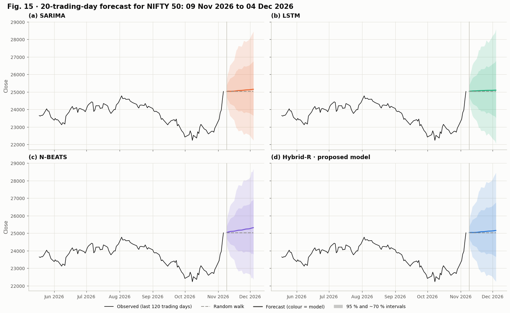

*Figure 15. Forecast beyond the last trading day.*

**Table 33 · NIFTY 50 close forecasts with 95 % intervals (last close 25,030.3 on 06 Nov 2026)**

|  | Hybrid-R | SARIMA | LSTM | N-BEATS | Hybrid-E | Random walk |
|---|---|---|---|---|---|---|
| Day 1 · 09 Nov 2026 | 25,039.9 [24,396.6, 25,700.2] | 25,030.8 [24,386.4, 25,692.2] | 25,034.4 [24,378.4, 25,708.1] | 25,045.7 [24,402.0, 25,706.3] | 25,034.4 [24,378.4, 25,708.1] | 25,030.3 |
| Day 2 · 10 Nov 2026 | 25,040.5 [24,094.6, 26,023.5] | 25,031.4 [24,086.6, 26,013.3] | 25,039.4 [24,110.6, 26,004.0] | 25,060.8 [24,110.6, 26,048.5] | 25,039.4 [24,110.6, 26,004.0] | 25,030.3 |
| Day 5 · 13 Nov 2026 | 25,041.7 [23,586.3, 26,586.8] | 25,032.6 [23,578.3, 26,576.5] | 25,052.5 [23,544.6, 26,657.0] | 25,103.2 [23,639.6, 26,657.3] | 25,052.5 [23,544.6, 26,657.0] | 25,030.3 |
| Day 10 · 20 Nov 2026 | 25,084.2 [22,767.2, 27,637.1] | 25,075.3 [22,758.5, 27,627.9] | 25,071.3 [22,779.0, 27,594.3] | 25,172.0 [22,830.4, 27,753.7] | 25,071.3 [22,779.0, 27,594.3] | 25,030.3 |
| Day 20 · 04 Dec 2026 | 25,158.7 [22,237.4, 28,463.8] | 25,149.7 [22,229.8, 28,453.1] | 25,097.7 [22,041.7, 28,577.4] | 25,321.1 [22,353.6, 28,682.6] | 25,110.1 [22,086.6, 28,547.6] | 25,030.3 |

**How to read Figure 15 and Table 33.** From the last close (25,030.3 on 6 November 2026) every model forecasts the next 20 trading days (dates approximate, holidays not modelled). The central forecasts stay close to the last close with a small upward drift (Hybrid-R 25,158.7 on 4 December 2026, N-BEATS the most optimistic at 25,321.1), while the 95 % intervals widen roughly with the square root of the horizon, to about 22,200 to 28,500 after 20 days. This is the honest shape of a market forecast: a nearly flat expected path and large uncertainty. These dates had not happened when the data were frozen, so the forecast can be checked later.

## C.17 The automatically written summary (notebook Section 17)

The notebook writes its own conclusions from the computed numbers, so the text can never disagree with the tables. This is the exact output of the run:

> **Headline result.** Day-ahead return RMSE reduction achieved by the proposed Hybrid-R on 1,197 unseen test days of the NIFTY 50 (positive = Hybrid-R better): **+0.18 %** vs Random walk (95 % CI -0.25 to +0.58 %, no significant difference); **+0.11 %** vs Drift (95 % CI -0.14 to +0.37 %, no significant difference); **+0.92 %** vs ARIMA (95 % CI +0.11 to +1.72 %, no significant difference); **+0.08 %** vs SARIMA (95 % CI -0.15 to +0.27 %, no significant difference); **+0.10 %** vs LSTM (95 % CI -0.24 to +0.41 %, no significant difference); **+0.04 %** vs N-BEATS (95 % CI -0.12 to +0.23 %, no significant difference). Its day-ahead R²_OS against the random walk is +0.35 % and its mean R²_OS over all 20 leads is +1.20 %. The best hybrid one day ahead is **Hybrid-R**. In the ablation, removing the neural correction changes the day-ahead R²_OS by -0.15 points and removing the auxiliary targets by +0.01 points (negative = the component helps).
>
> **Price accuracy.** One day ahead, every model's price forecast has an R² of at least 0.9966 on the
> 1,197 test days (Table 13), including the random walk. Price-level errors therefore confirm that the forecasts are
> well-behaved but cannot separate the models, exactly as expected in an efficient market.
>
> **Return accuracy (RQ1).** The decisive out-of-sample R² against the random walk ranges from -1.51 % to
> +0.35 %; the best day-ahead model is **Hybrid-R**. Models with a positive R²_OS (beating the random
> walk): SARIMA, LSTM, N-BEATS, Hybrid-R, Hybrid-E. Hybrid-R reaches R²_OS +0.35 % with a return RMSE of
> 0.8717 %. Against the random walk the difference in squared error is not significant (DM -0.80, p = 0.422); against its linear base SARIMA it is
> not significant (DM -0.66, p = 0.508).
>
> **Direction and economic value (RQ2).** Day-ahead directional accuracy ranges from 51.55 % to
> 53.22 % (50 % is a coin flip). Better than chance at the 5 % level (Pesaran-Timmermann):
> Hybrid-R. In the long-or-cash back-test after 0.05 % costs, the highest Sharpe
> ratio belongs to **Hybrid-R** (0.671) against 0.626 for buy and
> hold; strategies with a higher Sharpe ratio than buy and hold: Hybrid-R.
>
> **Horizon (RQ3).** Averaged over leads 1 to 20, the best mean R²_OS is +1.63 % (**N-BEATS**) and the worst is
> +0.83 % (**ARIMA**).
>
> **Uncertainty and risk (RQ4).** Hybrid-R's GARCH-scaled conformal intervals cover **98.0 %** of outcomes over all 20 leads
> (conservative), against 95.6 % for SARIMA's Gaussian GARCH intervals
> (well calibrated); the nominal level is 95 %. For one-day volatility the best forecast by QLIKE is
> **GARCH(1,1)** (Table 27), with GARCH persistence 0.9940.
>
> **Generalisation (RQ5).** Across the five assets Hybrid-R has a positive day-ahead R²_OS in **3 of 5** and a directional
> accuracy above 50 % in **4 of 5**. Mean rank across assets, day-ahead R²_OS: N-BEATS 2.0, SARIMA 3.0, Hybrid-R 3.6, Drift 4.0, Hybrid-E 4.3, LSTM 4.3, ARIMA 6.8;
> over all leads: N-BEATS 1.8, SARIMA 3.6, ARIMA 4.2, Hybrid-E 4.3, Hybrid-R 4.4, Drift 4.6, LSTM 5.1.
>
> **Take-away.** Prices are almost perfectly tracked, returns are barely predictable and volatility is strongly predictable. The honest
> contribution of the learned models is therefore measured in fractions of a percent of explained return variance, a small but real edge only
> where the significance tests above confirm it. The risk side (GARCH-scaled intervals and volatility forecasts) is where forecasting delivers
> clear, reliable value.

## C.18 Export (notebook Section 18)

```text
63 files written to outputs/  ·  bundle: outputs.zip (24.9 MB)
Total notebook runtime: 37.4 min
```

All 15 figures (300 dpi), 33 tables (CSV), the test predictions, the 20-day forecast, the market data, the trained networks and a `run_config.json` with every setting and library version are bundled into `outputs.zip`. The whole run took **37.4 minutes** on a Colab T4 GPU.


---

# Part D · Errors found and optimisations made

A good project is not one that worked first time; it is one whose problems were found, explained and fixed. This part tells that story, because examiners value it and because every fix taught something about forecasting markets.

## D.1 Data problems and their fixes

| Problem | How it showed up | Fix |
|---|---|---|
| Free APIs are rate-limited and revise history | repeated downloads blocked or slightly different from run to run | a **frozen snapshot** in `app/data/market/`, loaded from the local folder, then GitHub, then the live API as a last resort |
| Exchange holidays appear as empty rows | 31 NIFTY 50 rows without prices | rows with any missing price are dropped; the analysis uses trading days only |
| Dividends and splits create fake price jumps | Reliance and TCS raw prices fall on every ex-dividend day | all four prices are multiplied by adjusted close / close |
| Index volume missing for early years | volume zero on many NIFTY 50 days | volume features are used only if volume exists on 95 % of training days |
| VIX not published on some trading days | 18 to 27 gaps per Indian asset | carried forward for at most 5 days |
| A special Sunday session | 8 November 2026, a one-hour Diwali *Muhurat* session | the study ends on Friday 6 November 2026 |

## D.2 What went wrong in the first full run

The first complete run of an earlier version (before the fixes below) finished without any programming error, but the results revealed three modelling problems:

| Symptom in the first run | Diagnosis |
|---|---|
| Every LSTM member restored its weights from **epoch 1**, with validation loss rising from the very first epoch | the network was chasing noise; the validation years (with the COVID-19 crash and the rally that followed) were far more volatile than the training years, so a few crash days dominated the validation loss |
| The proposed **Hybrid-R was the worst model** one day ahead (R²_OS -1.13 %) | its linear base, ARIMA, was chosen by AIC and over-fitted the training years (R²_OS -1.51 %); the hybrid inherited the error |
| SARIMA chosen by AIC was also worse than the random walk (-1.43 %) | the same over-fitting: in-sample fit is not out-of-sample skill |

## D.3 The fixes, and why each one works

**Fix 1 · Choose the linear base on validation data, not by AIC.** SARIMA's orders are now selected by one-step RMSE on the validation years (Section C.8). The rule is the same as for every neural hyperparameter and never touches the test period. ARIMA deliberately keeps AIC selection so the paper can show the difference. The decisive lines inside `fit_sarima`:

```python
search = aic_search(c.y.iloc[:c.n_train], c.exog.iloc[:c.n_train], specs)
val = slice(c.n_train, c.n_train + c.n_val)
search["Validation RMSE (%)"] = [100 * np.sqrt(np.mean((c.r[val] - res.apply(c.y, exog=c.exog).fittedvalues.to_numpy()[val]) ** 2))
                                 for res in search["result"]]
search = search.sort_values(["converged", "Validation RMSE (%)"], ascending=[False, True]).reset_index(drop=True)
```

**Fix 2 · Hybrids built on SARIMA.** Both hybrids now use SARIMA as their statistical backbone, consistent with the companion weather study, and the ψ-weights are computed from the full seasonal lag polynomials (Section C.12).

**Fix 3 · GARCH-scaled targets.** The network targets are divided by GARCH's forecast volatility, $y_{t,h} = R_{t,h} / \hat s_{t,h}$ (Section C.10), so crash days no longer dominate the loss.

**Fix 4 · A random-walk start.** The output layer is initialised to zero, so every network starts as the random walk:

```python
outputs = keras.layers.Dense(n_outputs, kernel_initializer="zeros", bias_initializer="zeros", name="scaled_returns")(x)
```

With early stopping, a network that finds nothing stays at the random walk instead of producing noise.

**Fix 5 · Gentler training.** The search space now uses smaller learning rates (0.0001 to 0.001 instead of up to 0.003) and more dropout (0.2 to 0.5 instead of 0.1 to 0.3).

**Fix 6 · Readable learning curves.** Losses are plotted relative to the random walk on the same windows (Figure 5), so "below 1" always means "better than the random walk".

## D.4 Before and after

| Measure (NIFTY 50, test period, one day ahead) | First run | Documented run | Change |
|---|---|---|---|
| Hybrid-R R²_OS | -1.13 % (worst of 8) | **+0.35 % (best of 8)** | +1.48 points |
| SARIMA R²_OS | -1.43 % | **+0.20 %** | +1.63 points |
| N-BEATS R²_OS | -0.60 % | **+0.28 %** | +0.88 points |
| ARIMA R²_OS (AIC kept on purpose) | -1.51 % | -1.51 % | unchanged |
| Hybrid-R directional accuracy | 51.38 % | **53.22 %** (p = 0.0008) | +1.84 points |
| Hybrid-R trading Sharpe ratio | -0.089 | **0.671** | +0.760 |
| Models beating the random walk | 3 of 7 | **6 of 7** | |

In the first run the LSTM showed +0.39 %, but every one of its members had restored epoch-1 weights, so that number did not reflect a stable learned pattern. In the documented run the LSTM starts at the random walk and stays close to it (+0.16 %), which is the honest value.

## D.5 Engineering optimisations

| Optimisation | Effect |
|---|---|
| **One-pass vectorised Kalman forecasting** (Section C.7) | forecasts from all 1,715 origins at all 20 leads from a single filter pass instead of 1,715 separate runs; verified against statsmodels to a difference of exactly 0.0 |
| **Parallel model search** with `joblib` on all CPU cores | 16 ARIMA candidates in 15.5 s and 27 SARIMA candidates in 33.8 s |
| **Random search** instead of a full grid | 10 LSTM trainings instead of 243 (24 times fewer) for comparable quality (Bergstra & Bengio, 2012) |
| **Early stopping and learning-rate decay** | training stops when validation stops improving; the best weights are restored |
| **Memory release between assets** | after a Colab out-of-memory crash in the companion weather study, each asset's networks are saved and then released, so the five-asset run fits in a free Colab runtime |
| **Frozen data snapshot** | identical data in every run, no dependence on API limits |

The memory management code:

```python
def slim(c):
    for attr in HEAVY_ATTRIBUTES:
        if hasattr(c, attr):
            delattr(c, attr)
```

```python
def release_memory():
    get_reusable_executor().shutdown(wait=True)
    keras.backend.clear_session()
    gc.collect()
```

## D.6 Safeguards against data leakage

Leakage (accidentally using future information) is the most common reason published forecasting results do not replicate. This project guards against it at every step:

1. **Chronological split** with no shuffling; the test period is used exactly once.
2. **Causal features**: every feature at day $t$ uses only prices up to day $t$.
3. **Training-only estimation**: the feature scaler, the drift, GARCH, ARIMA and SARIMA parameters are estimated on 2008 to 2019 only.
4. **Validation-only decisions**: hyperparameters, early stopping, SARIMA orders, hybrid weights and interval calibration use only 2020 to 2021.
5. **Targets inside their period**: every neural training window has its whole 20-day target inside the training years.
6. **Frozen parameters**: during the test period models only update their state, exactly like a model deployed in practice.

---

# Part E · The volatility extension (latest notebook version)

The documented run showed that the *direction* of returns is almost unpredictable while their *size* is strongly predictable (GARCH persistence 0.994, Ljung-Box Q(10) of squared returns 736.6). The latest notebook version (commit `0c2eea7`, Section 15 of the notebook) builds on this with a full volatility-forecasting study. **Its results will be added to this document after the next Colab run**; this part explains the method.

## E.1 Measuring daily volatility precisely

A single squared return is a very noisy measure of a day's variance. With open, high, low and close prices the **Garman-Klass** estimator (1980) plus the squared overnight gap is far more precise:

$$RV_t = \underbrace{\ln^2\frac{O_t}{C_{t-1}}}_{\text{overnight}} + \underbrace{\tfrac12\ln^2\frac{H_t}{L_t} - (2\ln 2 - 1)\ln^2\frac{C_t}{O_t}}_{\text{intraday}} .$$

The intraday part uses the whole day's range, which contains far more information about volatility than the close alone. The targets are the average variance over the next 1, 5 and 22 trading days.

```python
def realised_variance(df):
    overnight = np.log(df["open"] / df["close"].shift(1)).fillna(0.0) ** 2
    intraday = 0.5 * np.log(df["high"] / df["low"]) ** 2 - (2 * np.log(2) - 1) * np.log(df["close"] / df["open"]) ** 2
    return (overnight + intraday.clip(lower=0.0)).to_numpy()
```

## E.2 Eight volatility models

| Model | Formula or idea |
|---|---|
| EWMA | $\hat\sigma^2_{t+1} = 0.94\,\hat\sigma^2_t + 0.06\,\varepsilon_t^2$ (RiskMetrics) |
| GARCH(1,1) | Section C.9, averaged over the horizon in closed form |
| GJR-GARCH(1,1) | $\sigma_t^2 = \omega + (\alpha + \gamma\,\mathbf 1\{\varepsilon_{t-1} < 0\})\,\varepsilon_{t-1}^2 + \beta\sigma_{t-1}^2$: bad news raises volatility more (Glosten et al., 1993) |
| HAR | $\ln RV^{(h)}_{t+1} = b_0 + b_d \ln RV_t + b_w \ln RV^{(5)}_t + b_m \ln RV^{(22)}_t + e$ (Corsi, 2009): daily, weekly and monthly memory |
| HAR-X | HAR plus $\ln \text{VIX}_t$, the market's own expectation of future risk |
| LSTM-V | LSTM on the features plus the HAR inputs, forecasting log variance at 1, 5 and 22 days |
| **Hybrid-V** (proposed) | HAR-X plus an LSTM that learns HAR-X's log errors, starting exactly at HAR-X |
| Hybrid-VE | optimal per-horizon weights between HAR-X and LSTM-V |

Models of log variance are converted back with **Duan's smearing factor** (1983). If $\ln RV = \hat\ell + e$, then $\mathbb E[RV] = e^{\hat\ell}\,\mathbb E[e^{e}]$, and the factor $\mathbb E[e^{e}]$ is estimated by the average of $e^{e}$ on the validation years. Without it, exponentiating a log forecast would systematically underestimate variance.

```python
def fit_har(c, design):
    coef = np.linalg.lstsq(design[c.vol_train], c.vol_targets[c.vol_train], rcond=None)[0]
    return design @ coef, coef
```

```python
def fit_hybrid_v(c):
    base = c.VLOG["HAR-X"]
    error = np.zeros(c.n)
    error[1:] = c.log_rv[1:] - base[:-1, 0]
    error = np.nan_to_num(error)
    scale = float(error[c.vol_train].std())
    c.X_hres = np.concatenate([c.X_vol, (error / scale)[:, None]], axis=1).astype("float32")
    residual = c.vol_targets - base
    c.vres_std = residual[c.vol_train].std(axis=0)
    target = lambda origins: (residual[origins] / c.vres_std).astype("float32")
    c.vres_members, c.vres_histories = vol_ensemble(c, c.X_hres, target, "hybrid_v_residual")
    log_forecast = base.copy()
    log_forecast[c.vol_all] = base[c.vol_all] + ensemble_predict(c.vres_members, c.X_hres, c.vol_all, c.vol_cfg["lookback"]) * c.vres_std
    return log_forecast
```

## E.3 How volatility forecasts are judged

**QLIKE loss** (Patton, 2011):

$$L(RV, \hat\sigma^2) = \frac{RV}{\hat\sigma^2} - \ln\frac{RV}{\hat\sigma^2} - 1 \;\ge\; 0 .$$

It is zero only for a perfect forecast, punishes under-prediction of risk more than over-prediction, and ranks models correctly even when the realised measure is noisy. Improvements are reported as $100\,(1 - \text{QLIKE}_P / \text{QLIKE}_C)$ with paired block-bootstrap intervals and Holm-corrected Diebold-Mariano tests, exactly as in Section C.13.4.

**Value-at-Risk back-test.** The one-day 99 % VaR is $\text{VaR}_t = -q_{0.01}\,\hat\sigma_{t+1}$, where $q_{0.01}$ is the 1 % quantile of the standardised returns on the validation years. A *violation* is a day with $r_{t+1} < -\text{VaR}_t$. With $n_1$ violations in $n$ days and $\hat\pi = n_1 / n$:

$$\text{LR}_{uc} = -2\ln\frac{(1-\alpha)^{\,n-n_1}\alpha^{\,n_1}}{(1-\hat\pi)^{\,n-n_1}\hat\pi^{\,n_1}} \sim \chi^2_1 \qquad \text{(Kupiec, 1995)},$$

which checks that violations happen on about 1 % of days, and the Christoffersen (1998) test adds a check that violations do not cluster:

$$\text{LR}_{cc} = \text{LR}_{uc} + \text{LR}_{ind} \sim \chi^2_2 .$$

**Volatility targeting** (Moreira & Muir, 2017). Hold the asset with weight

$$w_t = \min\left(\frac{\sigma^*}{\hat\sigma_{t+1}},\ 1.5\right),$$

where $\sigma^*$ is the training-period volatility: invest less when turbulence is forecast and more when markets are calm. Because volatility is predictable but returns are not, a better volatility forecast can raise the Sharpe ratio without any view on direction.

```python
def var_backtest(c, name, alpha):
    z = c.r[c.vol_val + 1] / np.sqrt(c.VFC[name][c.vol_val, 0])
    threshold = -np.quantile(z, alpha) * np.sqrt(c.VFC[name][c.vol_test, 0])
    hits = (c.r[c.vol_test + 1] < -threshold).astype(int)
    n, n1 = len(hits), int(hits.sum())
    pi = n1 / n
    lr_uc = max(0.0, -2 * (xlogy(n - n1, 1 - alpha) + xlogy(n1, alpha) - xlogy(n - n1, 1 - pi) - xlogy(n1, pi)))
    prev, curr = hits[:-1], hits[1:]
    n00, n01 = int(np.sum((prev == 0) & (curr == 0))), int(np.sum((prev == 0) & (curr == 1)))
    n10, n11 = int(np.sum((prev == 1) & (curr == 0))), int(np.sum((prev == 1) & (curr == 1)))
    p01, p11 = n01 / max(n00 + n01, 1), n11 / max(n10 + n11, 1)
    p_all = (n01 + n11) / max(n00 + n01 + n10 + n11, 1)
    lr_ind = max(0.0, -2 * (xlogy(n00 + n10, 1 - p_all) + xlogy(n01 + n11, p_all) - xlogy(n00, 1 - p01) - xlogy(n01, p01)
                            - xlogy(n10, 1 - p11) - xlogy(n11, p11)))
    result = {"violations": 100 * pi, "kupiec": float(stats.chi2.sf(lr_uc, 1)), "christoffersen": float(stats.chi2.sf(lr_uc + lr_ind, 2))}
    return result, threshold, hits
```

```python
def vol_target_returns(c, name):
    sigma = np.sqrt(TRADING_DAYS * c.VFC[name][c.vol_test, 0])
    weight = np.minimum(c.sigma * np.sqrt(TRADING_DAYS) / sigma, MAX_LEVERAGE)
    turnover = np.abs(np.diff(np.r_[0.0, weight]))
    return weight * np.expm1(c.r[c.vol_test + 1]) - COST * turnover, weight
```

## E.4 What to expect

Published research consistently finds that range-based HAR models clearly beat GARCH on volatility forecasts, so significant QLIKE improvements of Hybrid-V over EWMA and the GARCH family are likely. Gains over HAR-X itself, the strongest linear benchmark, are expected to be small, and the tables will report them as measured. This section is where the stock study is expected to produce its strongest, statistically significant results.

---

# Part F · Questions examiners will ask, with answers

**Q1. The price forecast lies exactly on the real price. Isn't that a perfect model?**
No. Even "tomorrow = today" gives a price R² of 0.9966 (Table 13). Close price curves only show that tomorrow is near today. Skill is measured on returns, against the random walk (Table 14).

**Q2. Your best R²_OS is only 0.35 %. Isn't that a failure?**
For daily stock returns it is a normal, positive result. The efficient-market hypothesis predicts R²_OS near zero, and published studies report values of the same order (Campbell & Thompson, 2008). What matters is beating the random walk out of sample, which Hybrid-R does, and being honest that the difference is not significant after correction.

**Q3. Why not predict the price directly with the LSTM?**
Prices are non-stationary (Table 4): a network trained on 2008 to 2019 price levels never saw the 2022 to 2026 levels. Returns are stationary, and prices are rebuilt exactly as $\hat P_{t+h} = P_t\,e^{\hat R_{t,h}}$.

**Q4. Is 53.22 % directional accuracy useful?**
It is significantly better than chance (Pesaran-Timmermann p = 0.0008) and it improved the back-test Sharpe ratio by 7.2 %. The honest caveat is that it comes from about 10 days on which Hybrid-R predicted a fall, so it is promising rather than proven.

**Q5. How do you know there is no data leakage?**
Section D.6 lists six safeguards. The strongest evidence is that the random walk is hard to beat in the results: leakage usually produces suspiciously large accuracy.

**Q6. Why SARIMA if stocks have no seasonality?**
SARIMA tests the day-of-the-week effect instead of assuming it away. The data answered: the weekly terms are not significant (Table 9), and validation picked a model with no ordinary ARMA terms. That is itself a finding.

**Q7. Why is the AIC-selected ARIMA so bad?**
AIC rewards fit on the training years. Daily return autocorrelations are tiny and unstable, so a model that fits 2008 to 2019 well can forecast 2022 to 2026 badly. Selecting on validation data fixed this for SARIMA (-1.43 % to +0.20 %).

**Q8. Why did the networks stop after one or a few epochs?**
Because there is little stable structure in daily returns. Thanks to the random-walk start, stopping early means "stay close to the random walk", the correct behaviour when nothing better is learnable (Figure 5).

**Q9. Why should we trust the confidence intervals and p-values?**
They use methods built for time series: the block bootstrap keeps the dependence between neighbouring days, the Diebold-Mariano test includes autocorrelation of the loss differential, and the Holm correction accounts for testing seven competitors at once.

**Q10. Does the result hold on other markets?**
Partly, and the notebook says so. Hybrid-R beats the random walk on NIFTY 50, NIFTY Bank and Reliance, but not on TCS or the S&P 500; N-BEATS is the most consistent model across assets (Table 28).

**Q11. What is new in this work?**
A stabilised residual hybrid (SARIMA plus an LSTM with GARCH-scaled targets, a random-walk start, multi-task auxiliary targets and ψ-weight propagation), an exact one-pass state-space evaluation of every origin, GARCH-scaled conformal intervals, and a fully leak-free, multi-asset, statistically tested comparison against modern baselines.

**Q12. What would you do next?**
Run the volatility study (Part E), add news and sentiment as inputs, and re-estimate the models periodically during the test period.

---

# Part G · Glossary and references

## Glossary

| Term | Meaning |
|---|---|
| Log return | $\ln(P_t / P_{t-1})$, approximately the percentage change |
| Random walk | the forecast "tomorrow equals today"; the efficient-market benchmark |
| Drift | the random walk plus the average daily training return |
| Stationary | statistical properties (mean, variance) do not change over time |
| Unit root | the property of a random walk; the series must be differenced |
| AIC | Akaike Information Criterion: fit minus a penalty for parameters |
| Kalman filter | the recursive algorithm that updates a state-space model's state with each new observation |
| GARCH | a model in which today's variance depends on yesterday's surprise and yesterday's variance |
| Persistence | $\alpha + \beta$ in GARCH: how slowly volatility shocks fade |
| LSTM | a recurrent neural network with gated memory |
| N-BEATS | a deep network of fully connected blocks with backcast and forecast outputs |
| Hybrid-R | the proposed model: SARIMA plus an LSTM that learns SARIMA's errors |
| Hybrid-E | a per-horizon weighted average of SARIMA and the LSTM |
| Epoch | one full pass of a network through the training data |
| Early stopping | ending training when the validation loss stops improving and restoring the best weights |
| Random search | sampling hyperparameter combinations at random instead of trying all of them |
| R²_OS | out-of-sample R² against the random walk; above 0 beats it |
| Directional accuracy | the share of days on which the predicted and actual signs agree |
| Pesaran-Timmermann test | tests whether directional accuracy is better than chance |
| Diebold-Mariano test | tests whether two forecasts have equal squared error |
| Holm correction | adjusts p-values when several comparisons are made at once |
| Block bootstrap | resampling blocks of consecutive days to build confidence intervals for dependent data |
| Conformal interval | a distribution-free prediction interval calibrated on held-out errors |
| Coverage | the share of outcomes that fall inside a prediction interval |
| Sharpe ratio | annualised mean return divided by annualised volatility |
| Maximum drawdown | the worst fall from a running peak |
| Ablation | removing one component at a time to measure its contribution |

## References

1. Bates, J. M., & Granger, C. W. J. (1969). The combination of forecasts. *Operational Research Quarterly*, 20(4), 451-468.
2. Bergstra, J., & Bengio, Y. (2012). Random search for hyper-parameter optimization. *Journal of Machine Learning Research*, 13, 281-305.
3. Bollerslev, T. (1986). Generalized autoregressive conditional heteroskedasticity. *Journal of Econometrics*, 31(3), 307-327.
4. Box, G. E. P., & Jenkins, G. M. (1970). *Time Series Analysis: Forecasting and Control*. Holden-Day.
5. Campbell, J. Y., & Thompson, S. B. (2008). Predicting excess stock returns out of sample: Can anything beat the historical average? *Review of Financial Studies*, 21(4), 1509-1531.
6. Christoffersen, P. F. (1998). Evaluating interval forecasts. *International Economic Review*, 39(4), 841-862.
7. Cont, R. (2001). Empirical properties of asset returns: stylized facts and statistical issues. *Quantitative Finance*, 1(2), 223-236.
8. Corsi, F. (2009). A simple approximate long-memory model of realized volatility. *Journal of Financial Econometrics*, 7(2), 174-196.
9. Diebold, F. X., & Mariano, R. S. (1995). Comparing predictive accuracy. *Journal of Business & Economic Statistics*, 13(3), 253-263.
10. Duan, N. (1983). Smearing estimate: A nonparametric retransformation method. *Journal of the American Statistical Association*, 78(383), 605-610.
11. Fama, E. F. (1970). Efficient capital markets: A review of theory and empirical work. *Journal of Finance*, 25(2), 383-417.
12. French, K. R. (1980). Stock returns and the weekend effect. *Journal of Financial Economics*, 8(1), 55-69.
13. Garman, M. B., & Klass, M. J. (1980). On the estimation of security price volatilities from historical data. *Journal of Business*, 53(1), 67-78.
14. Glosten, L. R., Jagannathan, R., & Runkle, D. E. (1993). On the relation between the expected value and the volatility of the nominal excess return on stocks. *Journal of Finance*, 48(5), 1779-1801.
15. Harvey, D., Leybourne, S., & Newbold, P. (1997). Testing the equality of prediction mean squared errors. *International Journal of Forecasting*, 13(2), 281-291.
16. Hochreiter, S., & Schmidhuber, J. (1997). Long short-term memory. *Neural Computation*, 9(8), 1735-1780.
17. Holm, S. (1979). A simple sequentially rejective multiple test procedure. *Scandinavian Journal of Statistics*, 6(2), 65-70.
18. Künsch, H. R. (1989). The jackknife and the bootstrap for general stationary observations. *The Annals of Statistics*, 17(3), 1217-1241.
19. Kupiec, P. H. (1995). Techniques for verifying the accuracy of risk measurement models. *Journal of Derivatives*, 3(2), 73-84.
20. Lakshminarayanan, B., Pritzel, A., & Blundell, C. (2017). Simple and scalable predictive uncertainty estimation using deep ensembles. *Advances in Neural Information Processing Systems*, 30.
21. Lei, J., G'Sell, M., Rinaldo, A., Tibshirani, R. J., & Wasserman, L. (2018). Distribution-free predictive inference for regression. *Journal of the American Statistical Association*, 113(523), 1094-1111.
22. Moreira, A., & Muir, T. (2017). Volatility-managed portfolios. *Journal of Finance*, 72(4), 1611-1644.
23. Oreshkin, B. N., Carpov, D., Chapados, N., & Bengio, Y. (2020). N-BEATS: Neural basis expansion analysis for interpretable time series forecasting. *International Conference on Learning Representations (ICLR)*.
24. Patton, A. J. (2011). Volatility forecast comparison using imperfect volatility proxies. *Journal of Econometrics*, 160(1), 246-256.
25. Pesaran, M. H., & Timmermann, A. (1992). A simple nonparametric test of predictive performance. *Journal of Business & Economic Statistics*, 10(4), 461-465.
26. Wilder, J. W. (1978). *New Concepts in Technical Trading Systems*. Trend Research.
27. Zhang, G. P. (2003). Time series forecasting using a hybrid ARIMA and neural network model. *Neurocomputing*, 50, 159-175.

---

*End of lecture notes. Every table, printed output and figure above was generated by the documented run of `app/final_stock_market.ipynb`; the code snippets are the actual functions of the notebook.*
